# @native-dev-kit/react-native-liquid-glass

Liquid Glass screens for React Native. On iOS they are a SwiftUI app's own screens, with Apple's real Liquid Glass. On Android they are a Jetpack Compose app's own screens, drawn with a Compose glass engine or, if you prefer, with Material 3.

<table>
<tr><th>iOS</th><th>Android, glass</th><th>Android, Material</th></tr>
<tr>
<td>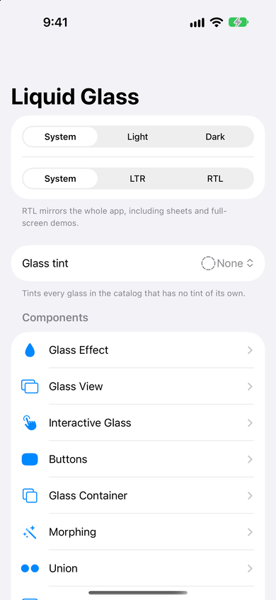</td>
<td>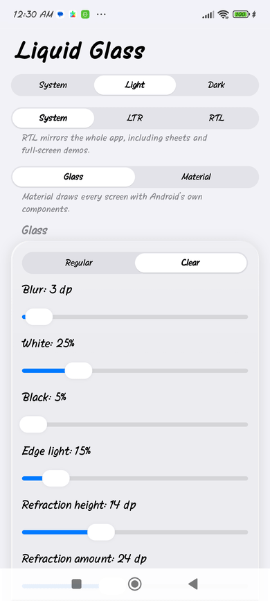</td>
<td>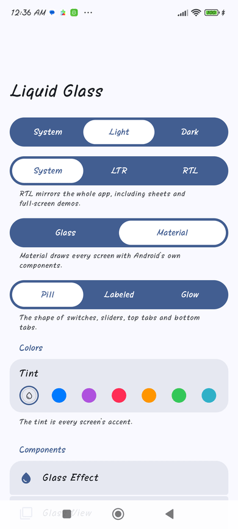</td>
</tr>
</table>

This library gives you **whole native screens**, not building blocks. Each screen draws its own title bar, back button, glass, controls, sheets and menus. You put a screen in your navigator and handle two events: open and back.

- **22 screens:** Home plus 21 catalog screens (glass effects, buttons, controls, toolbars, tab bars, search, sheets, alerts, transitions and more).
- **One settings provider:** appearance, tint, layout direction, fonts, icons and the Android options reach every screen, live.
- **Your fonts and icons** in every screen: icon fonts, SVG or images, keyed by SF Symbol name on both platforms.
- **Right-to-left** on both platforms.
- Works with React Navigation's native-stack. The library does not depend on it.

<table>
<tr><th>Morphing</th><th>Tab bar</th><th>Search</th><th>Mini player</th></tr>
<tr>
<td>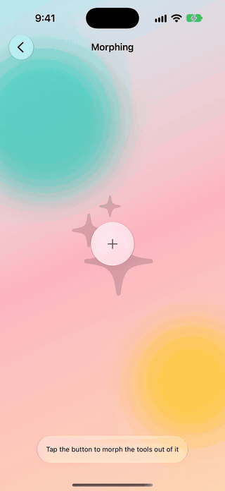</td>
<td>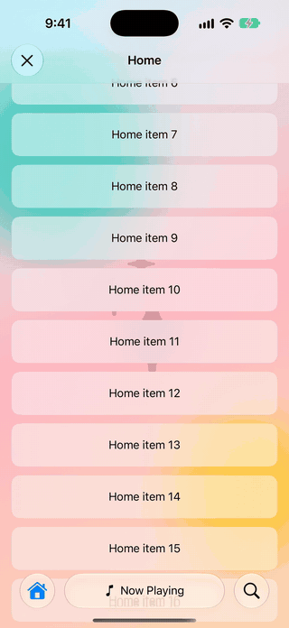</td>
<td>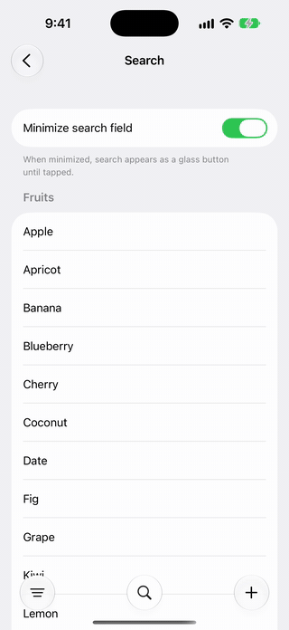</td>
<td>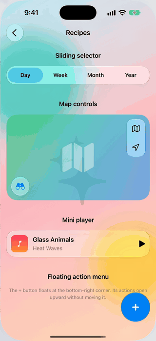</td>
</tr>
</table>

Every screen, with screenshots on both platforms: **[USAGE.md](https://github.com/dev-mohamedabdelnaby/react-native-liquid-glass/blob/main/USAGE.md)**.

## Requirements

| | Minimum |
|---|---|
| React Native | 0.88 (verified). New Architecture only. |
| iOS | 27.0 |
| Android | minSdk 26 (Android 8), compileSdk 37, Android Gradle Plugin 9.1 |
| Tooling | React Native CLI (bare app). **Expo is not supported yet.** |

The Android floor comes from the Compose BOM `2026.09.00` that the Android screens are built with.

## Install

```sh
npm install @native-dev-kit/react-native-liquid-glass
```

**iOS.** Set `platform :ios, '27.0'` in `ios/Podfile` (and the app target's deployment target), then install the pods with a UTF-8 locale:

```sh
cd ios && LANG=en_US.UTF-8 LC_ALL=en_US.UTF-8 pod install
```

The pod brings [SwiftDraw](https://github.com/swhitty/SwiftDraw) to draw SVG icons.

**Android.** In `android/build.gradle`, inside `buildscript { ext { … } }`:

```groovy
minSdkVersion = 26
compileSdkVersion = 37
kotlinVersion = "2.2.0" // the library applies the Compose compiler at this version
```

Use Android Gradle Plugin 9.1 or later, and keep `newArchEnabled=true`. The library brings Jetpack Compose and [AndroidSVG](https://github.com/BigBadaboom/androidsvg) (SVG icons).

Autolinking does the rest. Platform guides: [iOS](https://github.com/dev-mohamedabdelnaby/react-native-liquid-glass/blob/main/docs/ios.md), [Android](https://github.com/dev-mohamedabdelnaby/react-native-liquid-glass/blob/main/docs/android.md), [getting started](https://github.com/dev-mohamedabdelnaby/react-native-liquid-glass/blob/main/docs/getting-started.md).

## Quick start (React Navigation)

```tsx
import { useState } from 'react';
import { NavigationContainer } from '@react-navigation/native';
import { createNativeStackNavigator } from '@react-navigation/native-stack';
import {
  DEFAULT_SETTINGS,
  GlassButtonsScreen,
  GlassHomeScreen,
  GlassSettingsProvider,
  type GlassSettings,
} from '@native-dev-kit/react-native-liquid-glass';

const Stack = createNativeStackNavigator();

export default function App() {
  const [settings, setSettings] = useState<GlassSettings>(DEFAULT_SETTINGS);
  return (
    <GlassSettingsProvider value={settings}>
      <NavigationContainer>
        <Stack.Navigator
          screenOptions={{ headerShown: false, animation: 'ios_from_right' }}
        >
          <Stack.Screen name="Home">
            {({ navigation }) => (
              <GlassHomeScreen
                style={{ flex: 1 }}
                onOpen={(id) => {
                  if (id === 'buttons') navigation.navigate(id);
                }}
                onSettingsChange={setSettings}
              />
            )}
          </Stack.Screen>
          <Stack.Screen name="buttons">
            {({ navigation }) => (
              <GlassButtonsScreen style={{ flex: 1 }} onBack={navigation.goBack} />
            )}
          </Stack.Screen>
        </Stack.Navigator>
      </NavigationContainer>
    </GlassSettingsProvider>
  );
}
```

Three rules:

1. **Hide the navigator's header**: each screen draws its own bar.
2. **Give every screen `style={{ flex: 1 }}`**: screens have no default size and are blank without one.
3. **Feed `onSettingsChange` back into the provider**: Home's controls only report changes. If you do not store them and pass them back, they snap back and the other screens never see them. Keep the provider `value` stable (state or `useMemo`).

This sample registers only `buttons`. The recipe with all 22 screens, right-to-left animations and back handling: [docs/react-navigation.md](https://github.com/dev-mohamedabdelnaby/react-native-liquid-glass/blob/main/docs/react-navigation.md).

## The screens

| Component | Screen id | Home row | Bar title |
|---|---|---|---|
| `GlassHomeScreen` | `home` | — | Liquid Glass |
| `GlassEffectScreen` | `glassEffect` | Glass Effect | Glass Effect |
| `GlassViewScreen` | `glassView` | Glass View | Glass View |
| `InteractiveGlassScreen` | `interactive` | Interactive Glass | Interactive |
| `GlassButtonsScreen` | `buttons` | Buttons | Buttons |
| `GlassContainerScreen` | `container` | Glass Container | Container |
| `GlassMorphingScreen` | `morphing` | Morphing | Morphing |
| `GlassUnionScreen` | `union` | Union | Union |
| `GlassToolbarScreen` | `toolbar` | Toolbar | Toolbar |
| `GlassFloatingHeaderScreen` | `floatingHeader` | Floating Header | Floating Header |
| `GlassTabBarScreen` | `tabBar` | Tab Bar | Tab Bar |
| `GlassSheetsScreen` | `sheets` | Sheets & Menus | Sheets & Menus |
| `GlassControlsScreen` | `controls` | Controls | Controls |
| `GlassTextScreen` | `text` | Text | Text |
| `GlassTransitionsScreen` | `transitions` | Glass Transitions | Transitions |
| `GlassSearchScreen` | `search` | Search | Search |
| `GlassEditSearchScreen` | `editSearch` | Edit & Search Buttons | Notes |
| `GlassScrollEdgeScreen` | `scrollEdge` | Scroll Edge & Bars | Scroll Edge |
| `GlassSplitViewScreen` | `splitView` | Sidebar & Inspector | Split View |
| `GlassZoomTransitionsScreen` | `zoomTransitions` | Zoom Transitions | (none: a status pill) |
| `GlassAlertsScreen` | `alerts` | Alerts & Dialogs | Alerts & Dialogs |
| `GlassRecipesScreen` | `recipes` | Recipes | Recipes |

`GLASS_SCREENS` lists the 21 catalog screens (not Home) as `{ id, title }` in Home's order; `title` is the Home row title. Every screen takes the same props: `style`, `onBack`, `onOpen` and `onSettingsChange` (Home), `androidStyle`, `androidControlShape`, `androidGlowIntensity`, `fontFamily`, `icons`, `testID`. Details: [docs/screens.md](https://github.com/dev-mohamedabdelnaby/react-native-liquid-glass/blob/main/docs/screens.md).

## Settings

Wrap your navigator in one `GlassSettingsProvider`, as in the quick start. Missing keys keep `DEFAULT_SETTINGS`; providers nest.

| Setting | Default | iOS | Android |
|---|---|---|---|
| `appearance` | `'system'` | yes, **window-wide** | yes, inside the screen and the bar icons |
| `tint` | `null` | yes | yes (the accent in Material) |
| `layoutDirection` | `'system'` | yes | yes |
| `fontFamily` | `''` | yes | yes |
| `icons` | `{}` | yes | yes |
| `androidStyle` | `'glass'` | no | `'glass'` or `'material'` |
| `androidControlShape`, `androidGlowIntensity` | `'pill'`, `0.35` | no | Material only |
| `clear`, `blur`, `white`, `black`, `edgeLight`, `refraction`, `opaque`, `liquid`, `dropColor`, `sliderLiquid`, `switchLiquid`, `segmentedLiquid`, `tabBarLiquid`, `tabBarDrop` | see the guide | no | glass only |

Every setting: [docs/settings.md](https://github.com/dev-mohamedabdelnaby/react-native-liquid-glass/blob/main/docs/settings.md).

## Fonts, icons, right-to-left, Android style

<table>
<tr><th>Your font and icons (iOS)</th><th>Right-to-left (iOS)</th><th>Right-to-left (Android)</th><th>Material controls (Android)</th></tr>
<tr>
<td>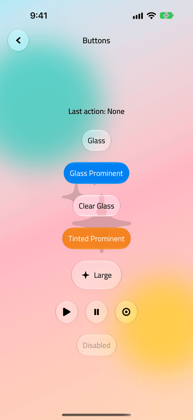</td>
<td>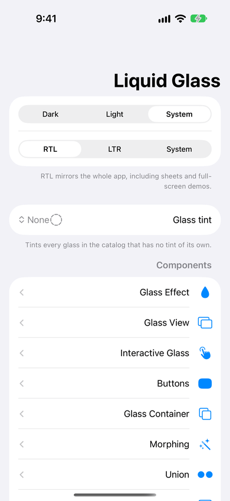</td>
<td>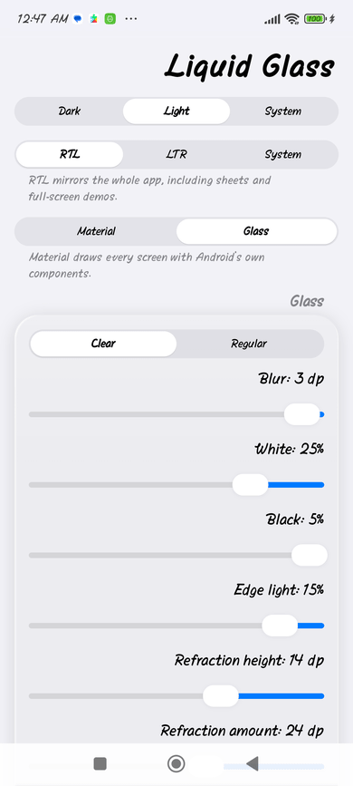</td>
<td>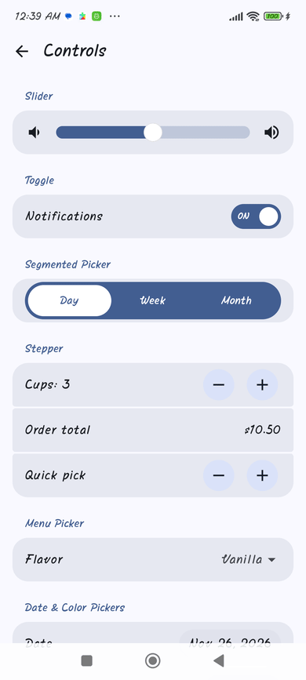</td>
</tr>
</table>

- **Fonts** (`fontFamily`): one family name, or a font per weight (`regular`, `medium`, `semibold`, `bold`, `heavy`). Add the files the React Native way (Android `assets/fonts`, iOS `UIAppFonts`). Texts the system draws (iOS alerts, menus, pickers, the share sheet, the keyboard) keep the system font. [Guide](https://github.com/dev-mohamedabdelnaby/react-native-liquid-glass/blob/main/docs/fonts.md).
- **Icons** (`icons`): keyed by SF Symbol name on both platforms. Values: `vectorIcon(IconSet, 'name')` for icon fonts such as react-native-vector-icons, `{ svg }` markup, or an image (`require('./icon.png')`, `{ uri }`). They take the place, size and tint of the icon they replace, flip in right-to-left when the replaced symbol flips, and keep its screen-reader label. [Guide](https://github.com/dev-mohamedabdelnaby/react-native-liquid-glass/blob/main/docs/icons.md).
- **Right-to-left** (`layoutDirection`): both platforms mirror; media players stay left to right. Pass `direction` to `NavigationContainer`. iOS `'system'` is right-to-left only when the app is localized for a right-to-left language. [Guide](https://github.com/dev-mohamedabdelnaby/react-native-liquid-glass/blob/main/docs/layout-direction.md).
- **Android style** (`androidStyle: 'material'`): the same screens with Material 3 components; `androidControlShape` picks pill, labeled or glow switches, sliders and tabs. [Guide](https://github.com/dev-mohamedabdelnaby/react-native-liquid-glass/blob/main/docs/android-style.md), [control shapes](https://github.com/dev-mohamedabdelnaby/react-native-liquid-glass/blob/main/docs/control-shapes.md).

## Known issues

- **iOS: `appearance` is window-wide.** A screen with `'light'` or `'dark'` sets the whole window's style, so your React Native screens and the status bar change too. The latest mounted glass screen asking for light or dark wins; when the last one unmounts, the window gets back its own style. Use `'system'` (which never touches the window) or match your app's style.
- **A mounted screen keeps its appearance request while off screen**: under a pushed screen, or in an inactive tab.
- **iOS: an `Appearance.setColorScheme` call made while a glass screen holds a request is lost** when the request ends; the window gets back the style it had before the first request.
- **Android back key:** on Android 16 (API 36) and later the activity must be a `NavigationEventDispatcherOwner` (React Native's `ReactActivity` is). Below that, the library reads the back key through the activity window's `Window.Callback`; a library that replaces it without passing events on breaks the routing until a glass screen enters the window again.
- **Two glass screens visible at once** (a transparent modal or form sheet over another glass screen): the Android back key goes to the one that entered the window last.
- **iOS, your own native-stack headers in run-time right-to-left (iOS 26+):** the back button can lose its chevron. The fix is a small native module that sets the window scene's layout-direction trait; see [layout direction](https://github.com/dev-mohamedabdelnaby/react-native-liquid-glass/blob/main/docs/layout-direction.md#ios-26-the-back-button-loses-its-chevron-in-run-time-rtl).
- Only React Navigation's native-stack is verified. Bottom tabs, the JS stack and React Native's `<Modal>` are untested.

More: [troubleshooting](https://github.com/dev-mohamedabdelnaby/react-native-liquid-glass/blob/main/docs/troubleshooting.md).

## Run the example

The example app in [`example/`](https://github.com/dev-mohamedabdelnaby/react-native-liquid-glass/tree/main/example) shows every screen. From the repository root:

```sh
yarn
yarn example start    # Metro on port 8081
yarn example ios
yarn example android
```

Set `CUSTOMIZE = true` in `example/src/customize.ts` to see a custom font (Cairo) and custom icons.

## For coding agents

- [USAGE.md](https://github.com/dev-mohamedabdelnaby/react-native-liquid-glass/blob/main/USAGE.md): every component, for explaining it to a user.
- [CONTEXT.md](https://github.com/dev-mohamedabdelnaby/react-native-liquid-glass/blob/main/CONTEXT.md): how the library works inside, the rules and the gotchas.
- [skills/react-native-liquid-glass/SKILL.md](https://github.com/dev-mohamedabdelnaby/react-native-liquid-glass/blob/main/skills/react-native-liquid-glass/SKILL.md): an agent skill.
- [llms.txt](https://github.com/dev-mohamedabdelnaby/react-native-liquid-glass/blob/main/llms.txt): an index of the docs.
- [AGENTS.md](https://github.com/dev-mohamedabdelnaby/react-native-liquid-glass/blob/main/AGENTS.md): working on this repository.

README, USAGE.md, CONTEXT.md, AGENTS.md, llms.txt and the skill ship in the npm package (`node_modules/@native-dev-kit/react-native-liquid-glass/`). The `docs/` guides and media are on GitHub only.

## Expo

Not supported yet. The library needs a bare React Native CLI app with the New Architecture. Support for Expo development builds is planned.

## Contributing

- [Development workflow](https://github.com/dev-mohamedabdelnaby/react-native-liquid-glass/blob/main/CONTRIBUTING.md#development-workflow)
- [Sending a pull request](https://github.com/dev-mohamedabdelnaby/react-native-liquid-glass/blob/main/CONTRIBUTING.md#sending-a-pull-request)
- [Code of conduct](https://github.com/dev-mohamedabdelnaby/react-native-liquid-glass/blob/main/CODE_OF_CONDUCT.md)

## License

MIT, see [LICENSE](https://github.com/dev-mohamedabdelnaby/react-native-liquid-glass/blob/main/LICENSE). The Android glass engine includes code under its own licenses: Apache 2.0 ([LICENSE-AndroidLiquidGlass](https://github.com/dev-mohamedabdelnaby/react-native-liquid-glass/blob/main/LICENSE-AndroidLiquidGlass)) and MIT ([LICENSE-Liquid-Glass-Android](https://github.com/dev-mohamedabdelnaby/react-native-liquid-glass/blob/main/LICENSE-Liquid-Glass-Android)). Both files ship in the package. The example's Cairo font is under the SIL Open Font License.
