# Using @native-dev-kit/react-native-liquid-glass

This guide explains every component in plain words: what it is, when to use it, how to add it, what it looks like on each platform and how it moves. It is written so that an AI assistant can explain the library to you, and so that you can read it yourself.

- Screenshots: iOS (iPhone, iOS 27), Android with the glass style, Android with the Material style. Light mode, left to right, default settings.
- Most animations (GIFs) were recorded on iOS. Where Android moves differently (the liquid controls, the glass tab bar, the Material glow controls), its own GIF is shown next to it. Elsewhere Android moves the same way unless a section says otherwise.
- The Android screenshots come from a Xiaomi phone, which draws its own status bar.

## The idea in one minute

The library gives you **whole screens**, not small pieces. Each component is one complete native screen: on iOS a SwiftUI screen with Apple's real Liquid Glass, on Android a Jetpack Compose screen. The screen draws its own title bar, back button, buttons, lists, sheets, menus and dialogs.

You put a screen in your app, give it a size, and react to two things: the user wants to go **back** (`onBack`), or, on the Home screen, wants to **open** another screen (`onOpen`).

There are 22 screens: **Home**, which lists all the others and has the settings, plus 21 catalog screens, one per Liquid Glass topic (buttons, controls, tab bars, search, sheets and more).

What it does not do:

- You cannot put your own React Native views inside a screen, and you cannot restyle its parts. A screen takes no children.
- There are no small building blocks such as a `GlassView` or a `GlassButton`.
- It needs a bare React Native app (React Native CLI) with the New Architecture. Expo is not supported yet.

## Before you start

| | Minimum |
|---|---|
| React Native | 0.88, New Architecture |
| iOS | 27.0 |
| Android | Android 8 (API 26); the app builds with compileSdk 37 and Android Gradle Plugin 9.1 |

Install:

```sh
npm install @native-dev-kit/react-native-liquid-glass
cd ios && LANG=en_US.UTF-8 LC_ALL=en_US.UTF-8 pod install
```

Set `platform :ios, '27.0'` in `ios/Podfile`, and `compileSdkVersion = 37`, `minSdkVersion = 26` and `kotlinVersion` in `android/build.gradle`. Step by step: [docs/getting-started.md](docs/getting-started.md), [docs/ios.md](docs/ios.md), [docs/android.md](docs/android.md).

## The three rules

1. **Give every screen a size**: `style={{ flex: 1 }}`. Without it the screen is invisible.
2. **Hide your navigator's header**: each screen draws its own bar.
3. **Keep the settings in state** and feed Home's `onSettingsChange` back into `GlassSettingsProvider`. Otherwise Home's controls do nothing lasting.

## Props every screen takes

| Prop | What it does |
|---|---|
| `style` | Size and place. Use `{ flex: 1 }`. |
| `onBack` | The user tapped the screen's back (or close) button. Go back here, for example `navigation.goBack()`. Home has no back button. |
| `onOpen` | Home only. The user tapped a row; you get the screen's id, for example `'buttons'`. Open that screen. |
| `onSettingsChange` | Home only. The user changed a setting on Home; you get all the settings. Store them and pass them back to the provider. |
| `androidStyle` | Android only. `'glass'` (default) or `'material'` for this screen. |
| `androidControlShape`, `androidGlowIntensity` | Android Material only. The look of this screen's switches, sliders and tabs. |
| `fontFamily` | Your font for this screen. |
| `icons` | Your icons for this screen, added to the provider's. |
| `testID` | For tests. |

Android's system back key and back gesture first close what is open inside a screen (a sheet, a menu, the search field), then go back. You do not need to handle it.

---

## The screens

Every catalog screen is added the same way. This is the smallest complete example, for the Buttons screen inside React Navigation's native stack:

```tsx
import { NavigationContainer } from '@react-navigation/native';
import { createNativeStackNavigator } from '@react-navigation/native-stack';
import { GlassButtonsScreen } from '@native-dev-kit/react-native-liquid-glass';

const Stack = createNativeStackNavigator();

export default function App() {
  return (
    <NavigationContainer>
      <Stack.Navigator screenOptions={{ headerShown: false }}>
        <Stack.Screen name="buttons">
          {({ navigation }) => (
            <GlassButtonsScreen style={{ flex: 1 }} onBack={navigation.goBack} />
          )}
        </Stack.Screen>
      </Stack.Navigator>
    </NavigationContainer>
  );
}
```

The sections below show each screen with its own minimal sample. The full app, with Home and all 21 screens, is in [docs/react-navigation.md](docs/react-navigation.md).

The **bar title** is the title the screen shows in its own bar. A few screens show a shorter title there than the name in Home's list; the sections say so.

### GlassHomeScreen (`home`)

The start screen. At the top, the settings: Appearance (System, Light, Dark), Layout direction (System, LTR, RTL), the glass tint, and on Android the style (Glass or Material) and the glass options. Below, the list of all 21 screens. Bar title: "Liquid Glass".

Use it as your app's entry into the catalog, or as a settings screen for the glass look.

```tsx
import { useState } from 'react';
import {
  DEFAULT_SETTINGS,
  GlassHomeScreen,
  GlassSettingsProvider,
  type GlassScreenId,
  type GlassSettings,
} from '@native-dev-kit/react-native-liquid-glass';

export function Home({ open }: { open: (id: GlassScreenId) => void }) {
  const [settings, setSettings] = useState<GlassSettings>(DEFAULT_SETTINGS);
  return (
    <GlassSettingsProvider value={settings}>
      <GlassHomeScreen
        style={{ flex: 1 }}
        onOpen={open}
        onSettingsChange={setSettings}
      />
    </GlassSettingsProvider>
  );
}
```

<table>
<tr><th>iOS</th><th>Android, glass</th><th>Android, Material</th></tr>
<tr>
<td>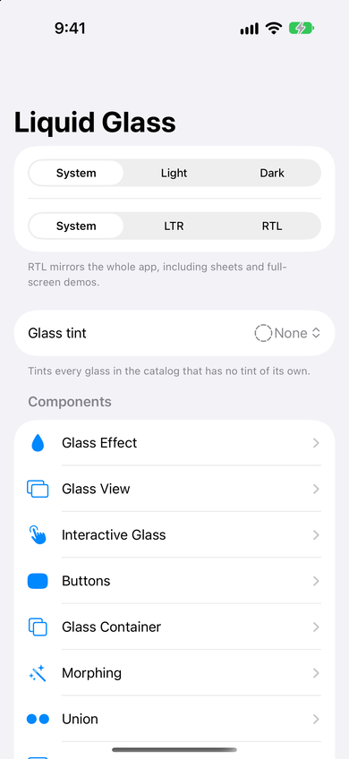</td>
<td>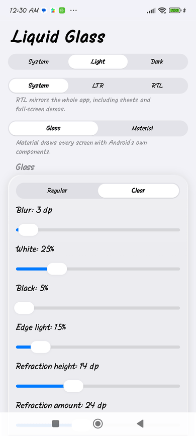</td>
<td>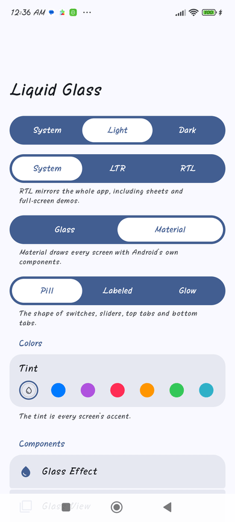</td>
</tr>
</table>

Dark appearance and right-to-left, set from Home's own controls:

<table>
<tr><th>iOS, Dark</th><th>Android glass, Dark</th><th>iOS, RTL</th><th>Android glass, RTL</th></tr>
<tr>
<td>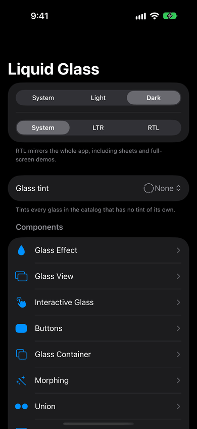</td>
<td>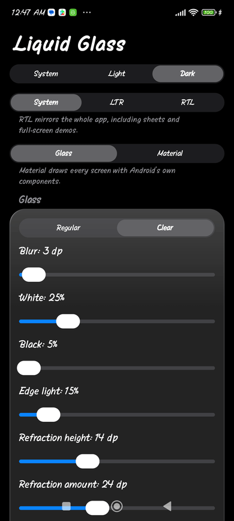</td>
<td>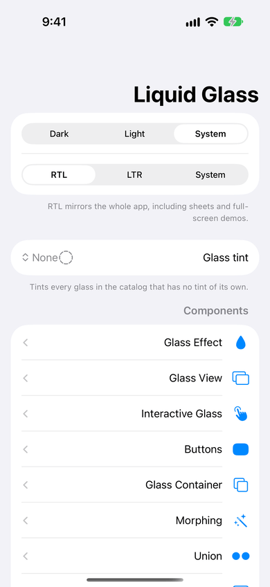</td>
<td>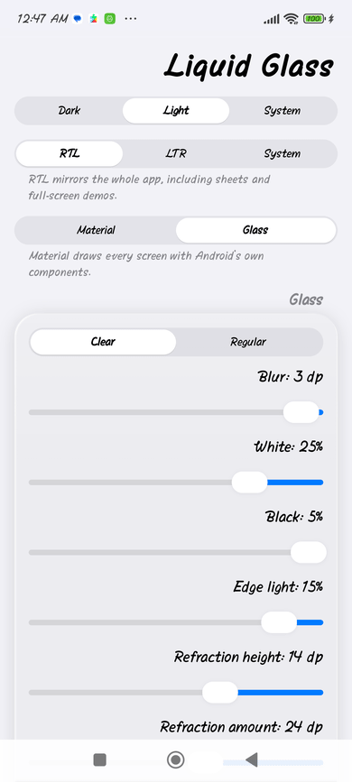</td>
</tr>
</table>

Good to know:

- Home's controls only **show** the settings and **report** changes through `onSettingsChange`. Store the result and pass it back to `GlassSettingsProvider`, as in the sample. Home keeps your font and icons when it reports a change.
- iOS Home shows Appearance, Layout direction and Glass tint. Android Home adds the Glass / Material picker; in Glass it shows the glass engine's options, in Material the control shape picker and the tint.
- On iOS, after you switch the layout direction, Home's list starts again at the top.

### GlassEffectScreen (`glassEffect`)

The basic glass material: a default glass capsule, the clear variant, tinted glass (orange, blue, green) and glass in other shapes (circle, rounded rectangle, rectangle), over a photo. Use it to show what Liquid Glass is.

```tsx
import { GlassEffectScreen } from '@native-dev-kit/react-native-liquid-glass';

export function GlassEffect({ onBack }: { onBack: () => void }) {
  return <GlassEffectScreen style={{ flex: 1 }} onBack={onBack} />;
}
```

<table>
<tr><th>iOS</th><th>Android, glass</th><th>Android, Material</th></tr>
<tr>
<td>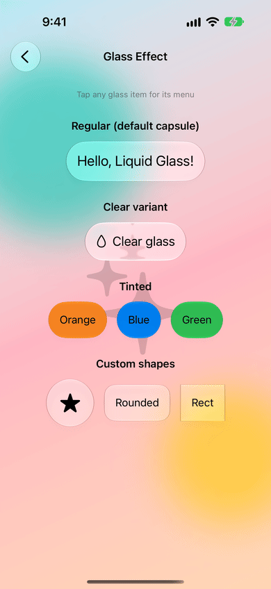</td>
<td>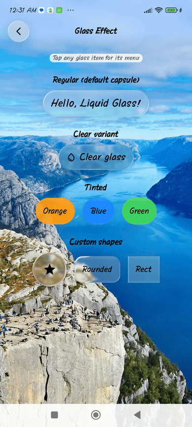</td>
<td>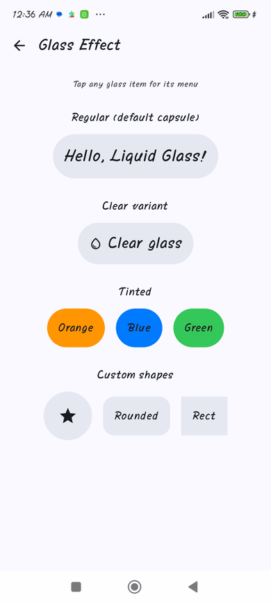</td>
</tr>
</table>

Material has no glass, so this screen shows tonal Material surfaces on a plain page instead.

### GlassViewScreen (`glassView`)

A glass card over a photo, with live options under it: Regular or Clear glass, the shape, the corner radius, interactive on or off, and a tint. Use it to let people try glass settings on one card.

```tsx
import { GlassViewScreen } from '@native-dev-kit/react-native-liquid-glass';

export function GlassViewDemo({ onBack }: { onBack: () => void }) {
  return <GlassViewScreen style={{ flex: 1 }} onBack={onBack} />;
}
```

<table>
<tr><th>iOS</th><th>Android, glass</th><th>Android, Material</th></tr>
<tr>
<td>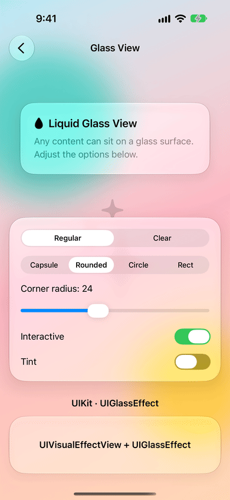</td>
<td>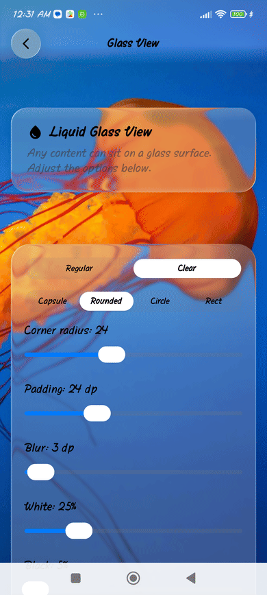</td>
<td>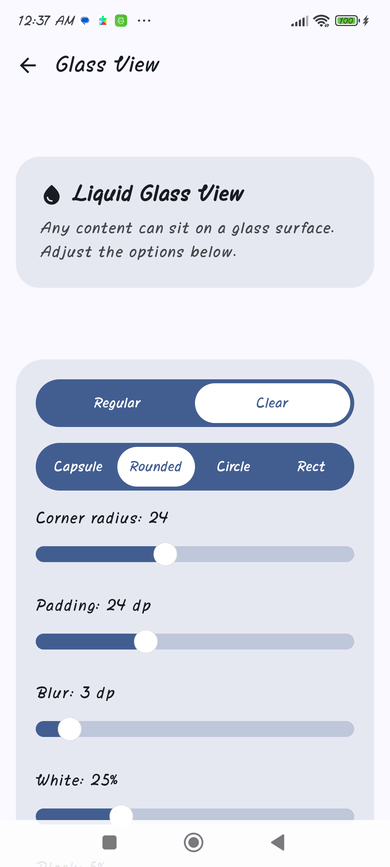</td>
</tr>
</table>

On Android glass, grey captions over the photo sit on a small plate so they stay readable.

### InteractiveGlassScreen (`interactive`)

Glass that reacts to touch: a shape that swells and glows while you press and hold it, a counter button, and static glass next to interactive glass. Bar title: "Interactive".

```tsx
import { InteractiveGlassScreen } from '@native-dev-kit/react-native-liquid-glass';

export function Interactive({ onBack }: { onBack: () => void }) {
  return <InteractiveGlassScreen style={{ flex: 1 }} onBack={onBack} />;
}
```

<table>
<tr><th>iOS</th><th>Android, glass</th><th>Android, Material</th><th>How it moves (iOS)</th></tr>
<tr>
<td>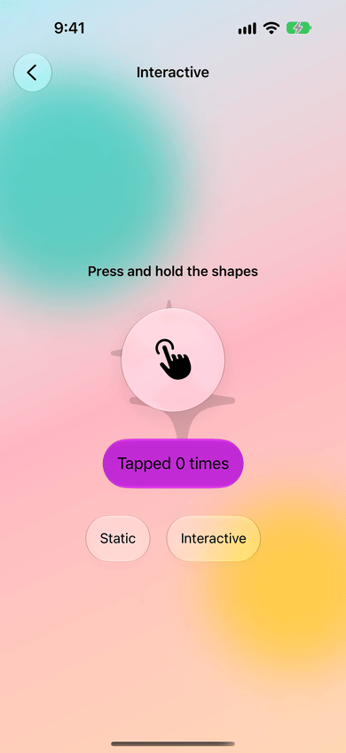</td>
<td>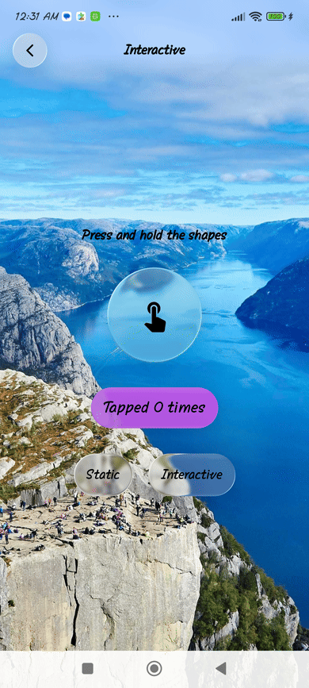</td>
<td>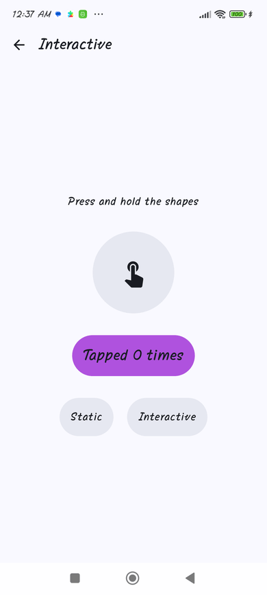</td>
<td>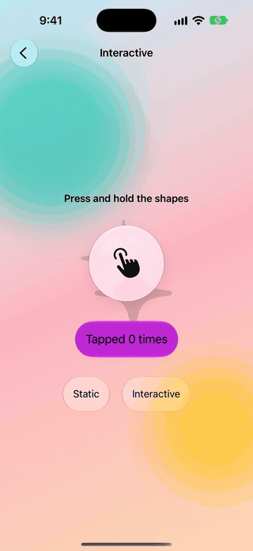</td>
</tr>
</table>

### GlassButtonsScreen (`buttons`)

Every button style: glass, glass prominent, clear, tinted prominent, a large button with an icon, a row of media buttons (back, play, forward) and a disabled button. Use it to pick a button look.

```tsx
import { GlassButtonsScreen } from '@native-dev-kit/react-native-liquid-glass';

export function Buttons({ onBack }: { onBack: () => void }) {
  return <GlassButtonsScreen style={{ flex: 1 }} onBack={onBack} />;
}
```

<table>
<tr><th>iOS</th><th>Android, glass</th><th>Android, Material</th></tr>
<tr>
<td>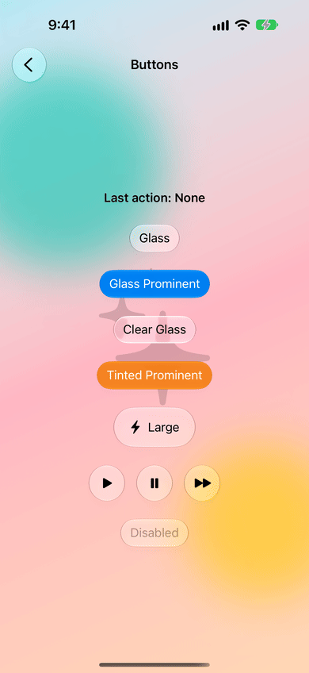</td>
<td>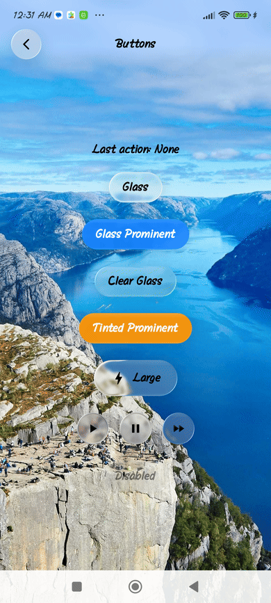</td>
<td>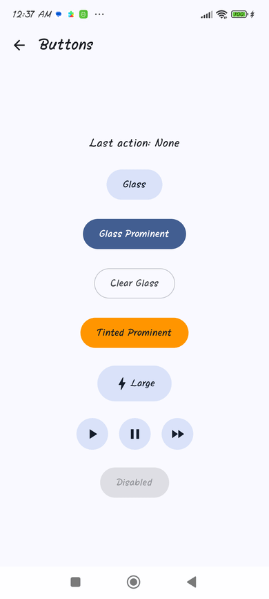</td>
</tr>
</table>

In right-to-left everything mirrors except the media row, which keeps play controls in their usual order. With your font and icons the same screen changes too:

<table>
<tr><th>iOS, RTL</th><th>Android glass, RTL</th><th>iOS, custom font and icons</th><th>Android glass, custom font and icons</th></tr>
<tr>
<td>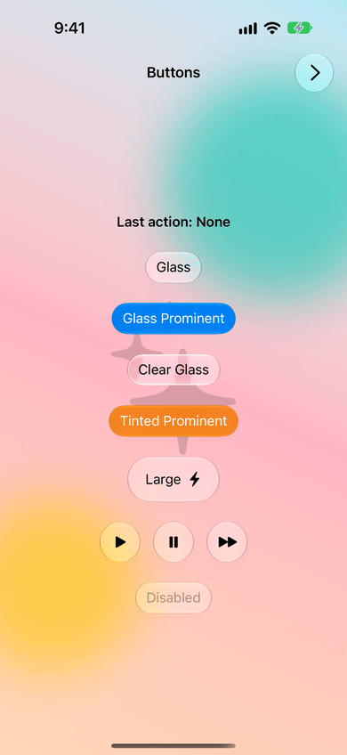</td>
<td>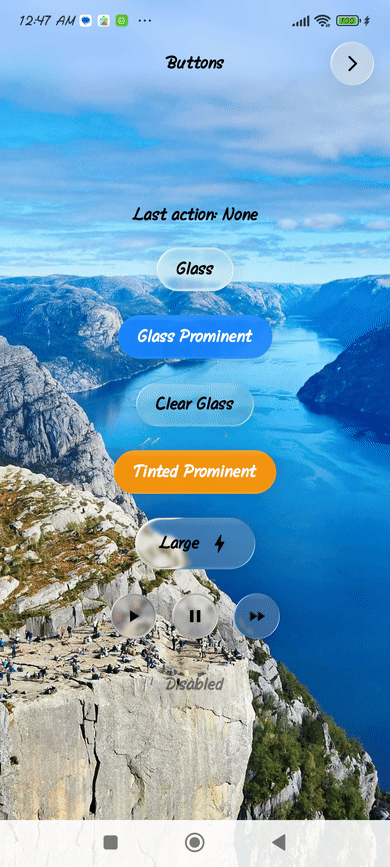</td>
<td>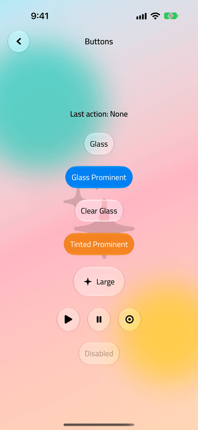</td>
<td>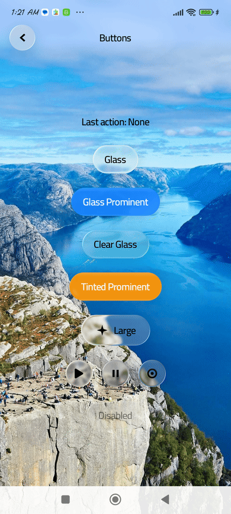</td>
</tr>
</table>

In Material the buttons are Android's own: filled, tonal, outlined and text buttons.

### GlassContainerScreen (`container`)

Two glass buttons inside a glass container. Drag "Pull together" and they melt into one shape; drag back and they split. "Container spacing" sets how close they must be to merge. Bar title: "Container".

```tsx
import { GlassContainerScreen } from '@native-dev-kit/react-native-liquid-glass';

export function Container({ onBack }: { onBack: () => void }) {
  return <GlassContainerScreen style={{ flex: 1 }} onBack={onBack} />;
}
```

<table>
<tr><th>iOS</th><th>Android, glass</th><th>Android, Material</th><th>How it moves (iOS)</th></tr>
<tr>
<td>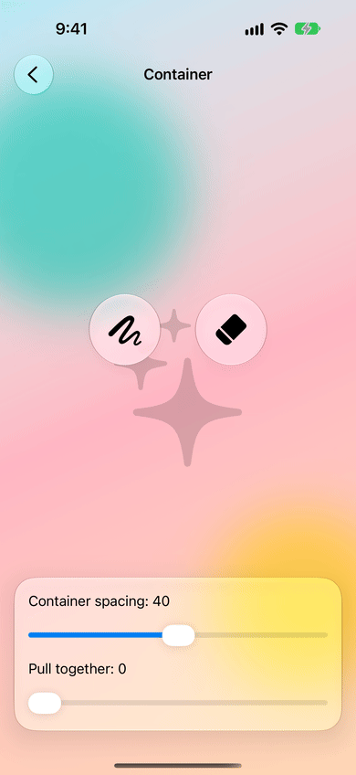</td>
<td>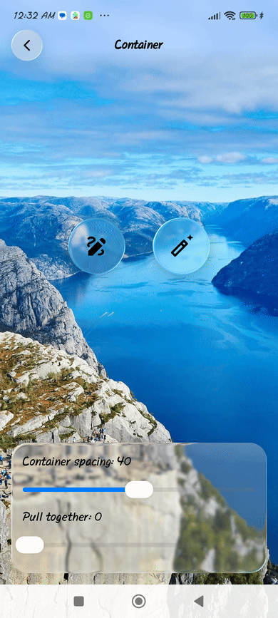</td>
<td>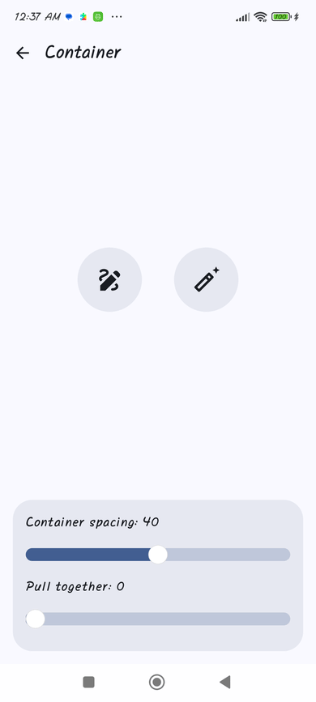</td>
<td>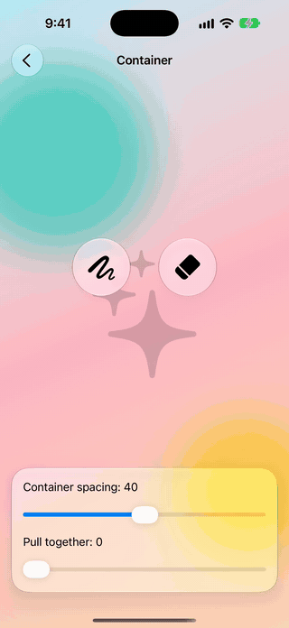</td>
</tr>
</table>

In Material the shapes are tonal surfaces and do not melt together.

### GlassMorphingScreen (`morphing`)

A + button. Tap it and a column of tool buttons grows out of it; tap the ✕ and they fold back in. Use it to show glass that changes shape.

```tsx
import { GlassMorphingScreen } from '@native-dev-kit/react-native-liquid-glass';

export function Morphing({ onBack }: { onBack: () => void }) {
  return <GlassMorphingScreen style={{ flex: 1 }} onBack={onBack} />;
}
```

<table>
<tr><th>iOS</th><th>Android, glass</th><th>Android, Material</th><th>How it moves (iOS)</th></tr>
<tr>
<td>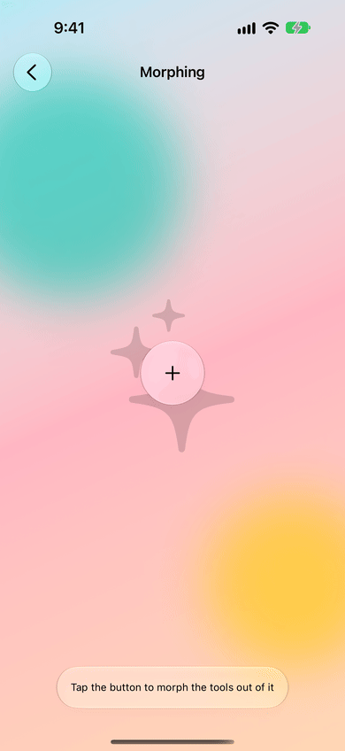</td>
<td>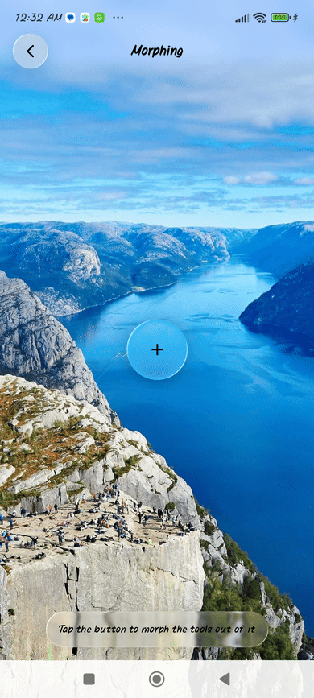</td>
<td>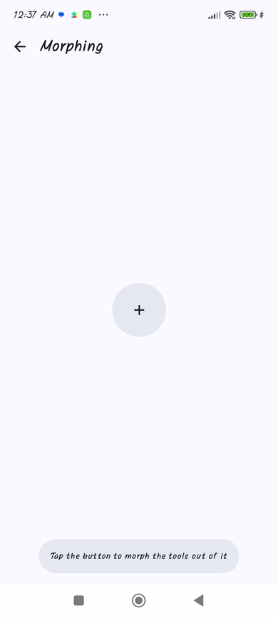</td>
<td>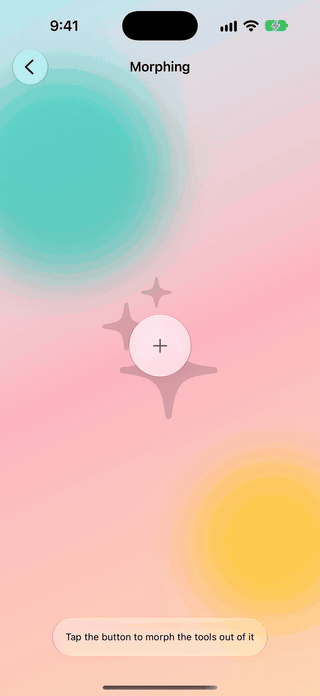</td>
</tr>
</table>

### GlassUnionScreen (`union`)

Day and night weather symbols grouped into two glass "unions" (several icons sharing one piece of glass), with a slider for the padding. Use it to show grouped glass.

```tsx
import { GlassUnionScreen } from '@native-dev-kit/react-native-liquid-glass';

export function Union({ onBack }: { onBack: () => void }) {
  return <GlassUnionScreen style={{ flex: 1 }} onBack={onBack} />;
}
```

<table>
<tr><th>iOS</th><th>Android, glass</th><th>Android, Material</th></tr>
<tr>
<td>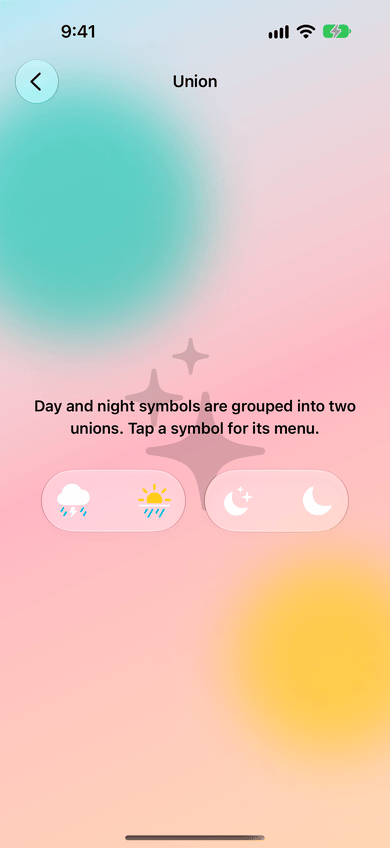</td>
<td>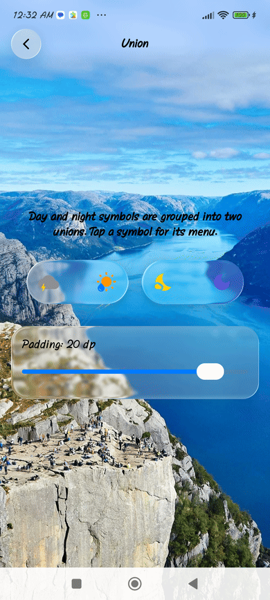</td>
<td>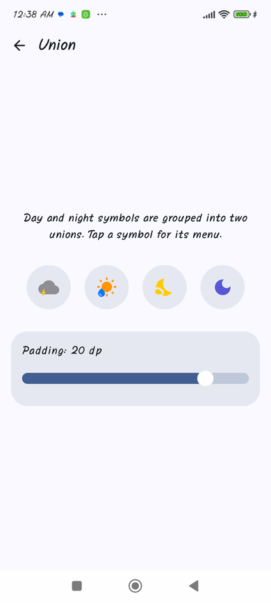</td>
</tr>
</table>

On Android, after "Show Details" in the menu, the details card appears once the menu has closed, about 0.3 s later.

### GlassToolbarScreen (`toolbar`)

A screen with a large title, glass toolbar buttons at the top (heart, share, more), a list of options, a bottom toolbar and a floating compose button. Use it to show glass bars.

```tsx
import { GlassToolbarScreen } from '@native-dev-kit/react-native-liquid-glass';

export function Toolbar({ onBack }: { onBack: () => void }) {
  return <GlassToolbarScreen style={{ flex: 1 }} onBack={onBack} />;
}
```

<table>
<tr><th>iOS</th><th>Android, glass</th><th>Android, Material</th></tr>
<tr>
<td>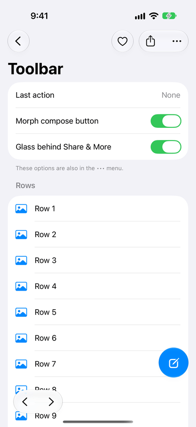</td>
<td>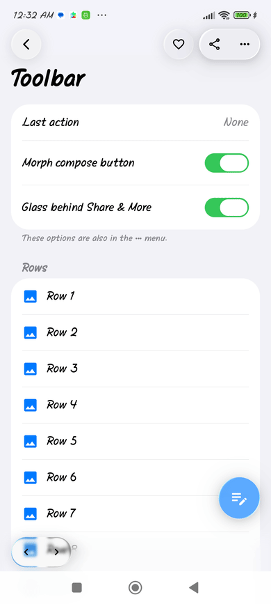</td>
<td>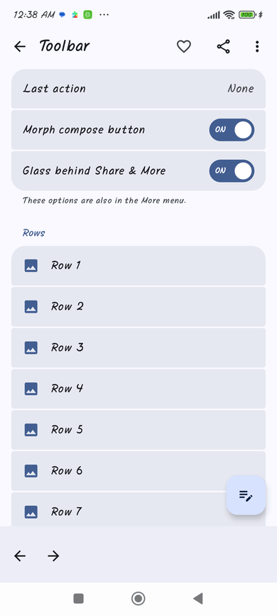</td>
</tr>
</table>

In Material: a top app bar with icon buttons, a bottom app bar and a floating action button.

### GlassFloatingHeaderScreen (`floatingHeader`)

A colourful header with glass bar buttons floating over a list, and a picker for the scroll-edge style under the status bar (Status Bar, Soft, None). Use it to show a header that content scrolls under.

```tsx
import { GlassFloatingHeaderScreen } from '@native-dev-kit/react-native-liquid-glass';

export function FloatingHeader({ onBack }: { onBack: () => void }) {
  return <GlassFloatingHeaderScreen style={{ flex: 1 }} onBack={onBack} />;
}
```

<table>
<tr><th>iOS</th><th>Android, glass</th><th>Android, Material</th><th>How it moves (iOS)</th></tr>
<tr>
<td>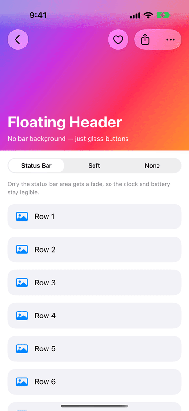</td>
<td>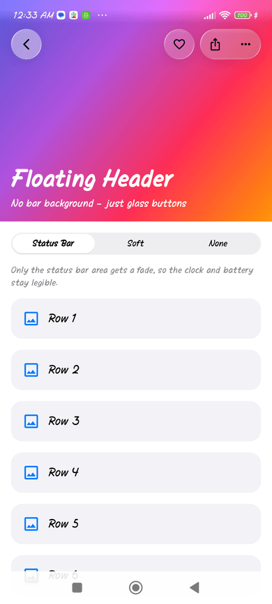</td>
<td>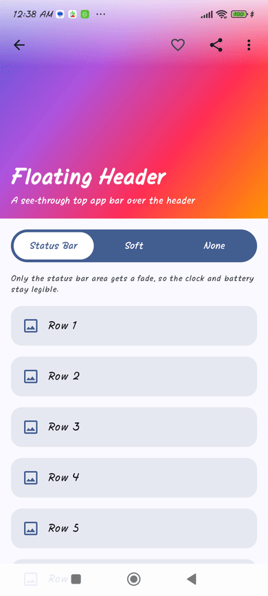</td>
<td>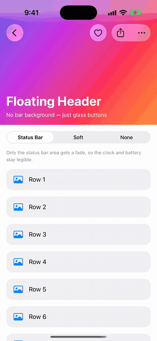</td>
</tr>
</table>

On Xiaomi phones in system dark mode, the status bar icons may turn white over the header in Light: the phone picks the icon colour from the content under it.

### GlassTabBarScreen (`tabBar`)

A launcher for floating glass tab bar demos: with a Now Playing bar, with search inside the tabs, with search separated, and tabs without search. Each demo opens full screen with its own close button. A switch turns "Minimize on scroll" on or off. Use it to show glass tab bars.

```tsx
import { GlassTabBarScreen } from '@native-dev-kit/react-native-liquid-glass';

export function TabBar({ onBack }: { onBack: () => void }) {
  return <GlassTabBarScreen style={{ flex: 1 }} onBack={onBack} />;
}
```

<table>
<tr><th>iOS</th><th>Android, glass</th><th>Android, Material</th></tr>
<tr>
<td>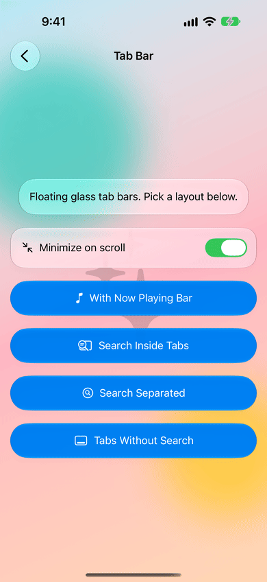</td>
<td>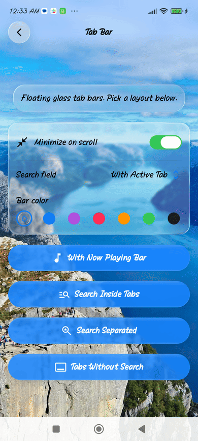</td>
<td>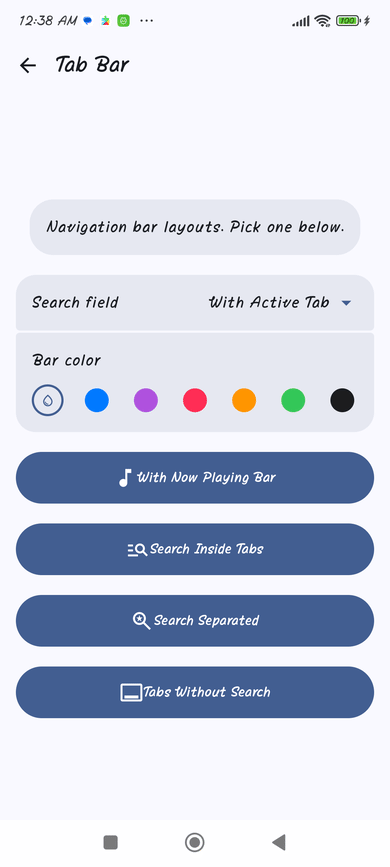</td>
</tr>
</table>

How it moves (iOS): switching tabs, and the bar minimizing while you scroll down.

<table>
<tr><th>Switching tabs</th><th>Minimize on scroll</th><th>With your font and icons</th></tr>
<tr>
<td>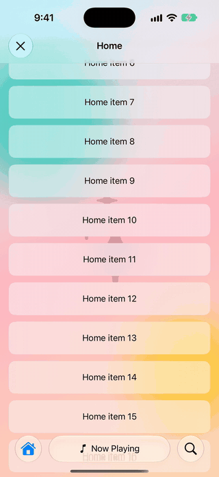</td>
<td>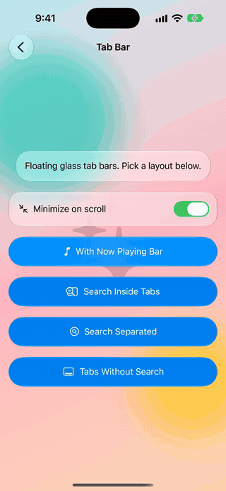</td>
<td>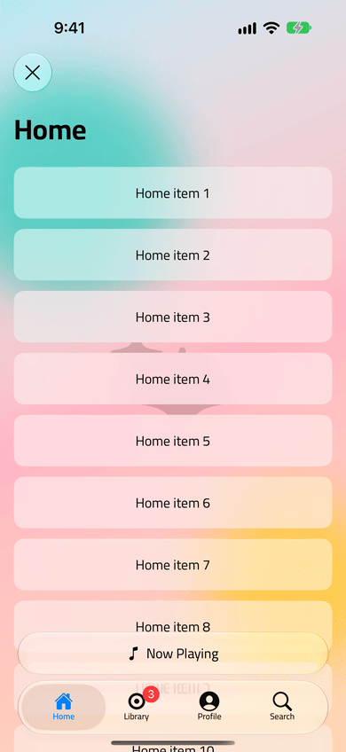</td>
</tr>
</table>

How it moves (Android glass): its own spring and the liquid drop under the selected tab.

<table>
<tr><th>Switching tabs</th><th>Minimize on scroll</th><th>With your font and icons</th></tr>
<tr>
<td>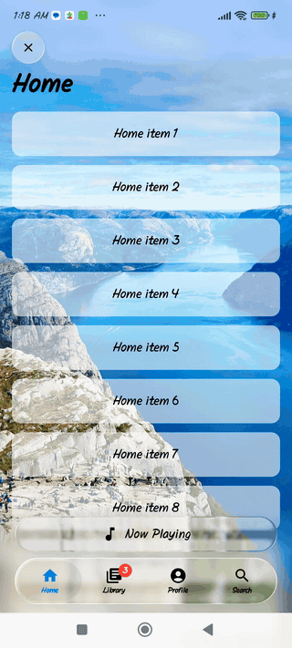</td>
<td>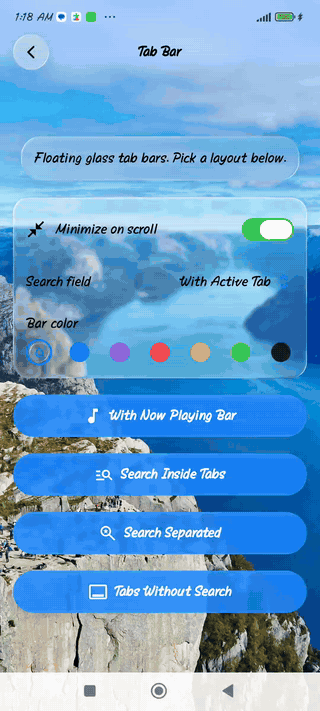</td>
<td></td>
</tr>
</table>

Platform differences:

- **iOS** minimizes the bar itself, with the system animation, when you scroll down; it comes back when you scroll back up.
- **Android glass** minimizes with its own spring and a liquid drop under the selected tab. Badges are round.
- **Android Material** uses a floating Material tab bar in the chosen control shape. It does not minimize, so the "Minimize on scroll" switch is hidden.

### GlassSheetsScreen (`sheets`)

"Show Sheet" opens a partial-height glass sheet, "Show Popover" a popover, and a glass button opens a menu. Use it to show sheets and menus.

```tsx
import { GlassSheetsScreen } from '@native-dev-kit/react-native-liquid-glass';

export function Sheets({ onBack }: { onBack: () => void }) {
  return <GlassSheetsScreen style={{ flex: 1 }} onBack={onBack} />;
}
```

<table>
<tr><th>iOS</th><th>Android, glass</th><th>Android, Material</th><th>How it moves (iOS)</th></tr>
<tr>
<td></td>
<td></td>
<td></td>
<td></td>
</tr>
</table>

In Material the sheet is a bottom sheet with a drag handle, and the popover and menu are dropdown menus. On Android the back key closes an open sheet or menu first.

### GlassControlsScreen (`controls`)

The standard controls: slider, toggle, segmented picker, steppers, a menu picker, and date and colour pickers. Use it to show glass controls.

```tsx
import { GlassControlsScreen } from '@native-dev-kit/react-native-liquid-glass';

export function Controls({ onBack }: { onBack: () => void }) {
  return <GlassControlsScreen style={{ flex: 1 }} onBack={onBack} />;
}
```

<table>
<tr><th>iOS</th><th>Android, glass</th><th>Android, Material (pill shape)</th></tr>
<tr>
<td></td>
<td></td>
<td></td>
</tr>
</table>

<table>
<tr><th>How it moves (Android glass): liquid controls</th><th>How it moves (Android Material): glow shape</th></tr>
<tr>
<td></td>
<td></td>
</tr>
</table>

- Android glass uses liquid controls: a drop of glass slides under the thumb. The Android glass options on Home can turn each liquid effect off.
- Android Material draws the switch, slider, segmented picker and tab bar in one of three shapes: `'pill'` (default, shown), `'labeled'` or `'glow'`. See [Android control shapes](#android-control-shapes).
- iOS draws the date, time and colour pickers itself, so they keep the system font.

### GlassTextScreen (`text`)

Text and glass: letters cut from glass, a large title on glass, a tinted headline, a paragraph card and tags. Use it to show text on glass.

```tsx
import { GlassTextScreen } from '@native-dev-kit/react-native-liquid-glass';

export function TextDemo({ onBack }: { onBack: () => void }) {
  return <GlassTextScreen style={{ flex: 1 }} onBack={onBack} />;
}
```

<table>
<tr><th>iOS</th><th>Android, glass</th><th>Android, Material</th></tr>
<tr>
<td></td>
<td></td>
<td></td>
</tr>
</table>

### GlassTransitionsScreen (`transitions`)

How glass appears and disappears. Pick Matched, Materialize or Identity, then tap "Show Badges": the badges grow out of the avatar's glass, and "Hide Badges" folds them back. Bar title: "Transitions".

```tsx
import { GlassTransitionsScreen } from '@native-dev-kit/react-native-liquid-glass';

export function Transitions({ onBack }: { onBack: () => void }) {
  return <GlassTransitionsScreen style={{ flex: 1 }} onBack={onBack} />;
}
```

<table>
<tr><th>iOS</th><th>Android, glass</th><th>Android, Material</th><th>How it moves (iOS, Matched)</th></tr>
<tr>
<td></td>
<td></td>
<td></td>
<td></td>
</tr>
</table>

### GlassSearchScreen (`search`)

A fruit list with a glass search button in the bottom bar. Tap it and it opens into a search field; typing filters the list; closing folds it back.

```tsx
import { GlassSearchScreen } from '@native-dev-kit/react-native-liquid-glass';

export function Search({ onBack }: { onBack: () => void }) {
  return <GlassSearchScreen style={{ flex: 1 }} onBack={onBack} />;
}
```

<table>
<tr><th>iOS</th><th>Android, glass</th><th>Android, Material</th><th>How it moves (iOS)</th></tr>
<tr>
<td></td>
<td></td>
<td></td>
<td></td>
</tr>
</table>

In Material the search is a search bar at the top, under the top app bar, and the iOS "Minimize search field" switch is hidden. On Android the back key closes the open search first.

### GlassEditSearchScreen (`editSearch`)

A notes list with glass Edit and Search buttons, as in a notes app. Bar title: "Notes".

```tsx
import { GlassEditSearchScreen } from '@native-dev-kit/react-native-liquid-glass';

export function Notes({ onBack }: { onBack: () => void }) {
  return <GlassEditSearchScreen style={{ flex: 1 }} onBack={onBack} />;
}
```

<table>
<tr><th>iOS</th><th>Android, glass</th><th>Android, Material</th></tr>
<tr>
<td></td>
<td></td>
<td></td>
</tr>
</table>

In Material, search opens from the top bar's search action, and editing turns the bar into a contextual bar (Delete, Done).

### GlassScrollEdgeScreen (`scrollEdge`)

Filter chips, coloured rows, and a picker for how content fades under the bars (Auto, Soft, Hard, Hidden). Bar title: "Scroll Edge".

```tsx
import { GlassScrollEdgeScreen } from '@native-dev-kit/react-native-liquid-glass';

export function ScrollEdge({ onBack }: { onBack: () => void }) {
  return <GlassScrollEdgeScreen style={{ flex: 1 }} onBack={onBack} />;
}
```

<table>
<tr><th>iOS</th><th>Android, glass</th><th>Android, Material</th></tr>
<tr>
<td></td>
<td></td>
<td></td>
</tr>
</table>

In Material the filters and edge styles are filter chips.

### GlassSplitViewScreen (`splitView`)

A sidebar, content and inspector layout. On a phone the screen explains it and "Open Split View" opens the demo full screen. Bar title: "Split View".

```tsx
import { GlassSplitViewScreen } from '@native-dev-kit/react-native-liquid-glass';

export function SplitView({ onBack }: { onBack: () => void }) {
  return <GlassSplitViewScreen style={{ flex: 1 }} onBack={onBack} />;
}
```

<table>
<tr><th>iOS</th><th>Android, glass</th><th>Android, Material</th></tr>
<tr>
<td></td>
<td></td>
<td></td>
</tr>
</table>

### GlassZoomTransitionsScreen (`zoomTransitions`)

A mail-style screen: an Online status, an inbox button with a badge, a "New Message" button and a stepper for the unread badge. "New Message" opens a sheet that zooms out of the button and back into it. It has no bar title; a status pill sits there.

```tsx
import { GlassZoomTransitionsScreen } from '@native-dev-kit/react-native-liquid-glass';

export function ZoomTransitions({ onBack }: { onBack: () => void }) {
  return <GlassZoomTransitionsScreen style={{ flex: 1 }} onBack={onBack} />;
}
```

<table>
<tr><th>iOS</th><th>Android, glass</th><th>Android, Material</th><th>How it moves (iOS)</th></tr>
<tr>
<td></td>
<td></td>
<td></td>
<td></td>
</tr>
</table>

### GlassAlertsScreen (`alerts`)

"Show Alert", "Show Confirmation Dialog", and a long press on the artwork for a context menu. Use it to show alerts and menus.

```tsx
import { GlassAlertsScreen } from '@native-dev-kit/react-native-liquid-glass';

export function Alerts({ onBack }: { onBack: () => void }) {
  return <GlassAlertsScreen style={{ flex: 1 }} onBack={onBack} />;
}
```

<table>
<tr><th>iOS</th><th>Android, glass</th><th>Android, Material</th></tr>
<tr>
<td></td>
<td></td>
<td></td>
</tr>
</table>

- iOS draws alerts, confirmation dialogs and context menus itself: they keep the system font even when you set `fontFamily`.
- In Material, alerts and the confirmation are Android dialogs; the context menu opens at the pressed item.

### GlassRecipesScreen (`recipes`)

Ready-made patterns: a sliding selector, map controls, a mini music player that expands when tapped, and a floating action menu. Use it as a source of ideas.

```tsx
import { GlassRecipesScreen } from '@native-dev-kit/react-native-liquid-glass';

export function Recipes({ onBack }: { onBack: () => void }) {
  return <GlassRecipesScreen style={{ flex: 1 }} onBack={onBack} />;
}
```

<table>
<tr><th>iOS</th><th>Android, glass</th><th>Android, Material</th></tr>
<tr>
<td></td>
<td></td>
<td></td>
</tr>
</table>

<table>
<tr><th>How it moves (iOS): the mini player</th><th>iOS, RTL: the player stays left to right</th><th>Android glass, RTL: the same</th></tr>
<tr>
<td></td>
<td></td>
<td></td>
</tr>
</table>

Music players stay left to right in right-to-left layouts, on both platforms, because media controls follow time, not reading direction.

---

## Settings: GlassSettingsProvider

Settings change every screen at once. Put one `GlassSettingsProvider` around your screens and pass it your settings. Missing keys keep their defaults (`DEFAULT_SETTINGS`).

```tsx
import { useMemo, type ReactNode } from 'react';
import { GlassSettingsProvider } from '@native-dev-kit/react-native-liquid-glass';

export function DarkPurpleGlass({ children }: { children: ReactNode }) {
  const value = useMemo(
    () => ({ appearance: 'dark' as const, tint: '#AF52DE' }),
    []
  );
  return <GlassSettingsProvider value={value}>{children}</GlassSettingsProvider>;
}
```

Keep `value` stable: state or `useMemo`, not an object written inline in a component that re-renders often.

| Setting | Default | What it does | Platforms |
|---|---|---|---|
| `appearance` | `'system'` | `'light'`, `'dark'` or follow the device. | both |
| `tint` | `null` | A colour for all glass that has no colour of its own. In Material it is the accent colour. | both |
| `layoutDirection` | `'system'` | `'ltr'`, `'rtl'` or follow the device. | both |
| `fontFamily` | `''` | Your font. See [Fonts](#fonts). | both |
| `icons` | `{}` | Your icons. See [Icons](#icons). | both |
| `androidStyle` | `'glass'` | `'material'` draws the Android screens with Material 3. | Android |
| `androidControlShape` | `'pill'` | Material switches, sliders and tabs: `'pill'`, `'labeled'`, `'glow'`. | Android Material |
| `androidGlowIntensity` | `0.35` | How strongly `'glow'` glows, 0 to 1. | Android Material |
| `clear`, `blur`, `white`, `black`, `edgeLight`, `refraction`, `opaque`, `liquid`, `dropColor`, `sliderLiquid`, `switchLiquid`, `segmentedLiquid`, `tabBarLiquid`, `tabBarDrop` | see [docs/settings.md](docs/settings.md) | The Android glass engine's look. | Android glass |

Things to know about `appearance`:

- **On iOS it changes the whole app window**, your own React Native screens and the status bar included, because that is how SwiftUI's dark mode works. Use `'system'` if your other screens must not change.
- A screen keeps its light or dark request while it is mounted, even when it is hidden under another screen. When the last such screen goes away, the app's own look comes back.
- On iOS, if your app calls `Appearance.setColorScheme` while a glass screen holds a request, your value is lost when the request ends.
- On Android it changes only the glass screens and the status and navigation bar icons.

Full reference: [docs/settings.md](docs/settings.md).

## Fonts

Use your app's own font in every text the screens draw. Give one family name, or a font per weight:

```tsx
import type { ReactNode } from 'react';
import {
  GlassSettingsProvider,
  type GlassSettings,
} from '@native-dev-kit/react-native-liquid-glass';

const settings: GlassSettings = {
  fontFamily: {
    regular: 'Cairo-Regular',
    medium: 'Cairo-Medium',
    semibold: 'Cairo-SemiBold',
    bold: 'Cairo-Bold',
    heavy: 'Cairo-ExtraBold',
  },
};

export function WithCairo({ children }: { children: ReactNode }) {
  return <GlassSettingsProvider value={settings}>{children}</GlassSettingsProvider>;
}
```

Add the font files the usual React Native way: Android `android/app/src/main/assets/fonts/`, iOS the app target plus `UIAppFonts` in `Info.plist`. Texts the system draws (iOS alerts, menus, pickers, the share sheet, the keyboard) keep the system font.

<table>
<tr><th>iOS Home with Cairo and custom icons</th><th>iOS Tab Bar launcher with Cairo</th><th>Android Home with Cairo</th><th>Android Tab Bar launcher with Cairo</th></tr>
<tr>
<td></td>
<td></td>
<td></td>
<td></td>
</tr>
</table>

More: [docs/fonts.md](docs/fonts.md).

## Icons

Swap any icon the screens draw for your own. The key is the **SF Symbol name** the screen uses there, on both platforms (for example `'heart'`, `'square.and.arrow.up'`, `'magnifyingglass'`). The value can be:

- a glyph from an icon font, with `vectorIcon(IconSet, 'name')` (react-native-vector-icons or any set with `getRawGlyphMap()` and `getFontFamily()`),
- SVG markup: `{ svg: '<svg …>…</svg>' }`,
- an image: `require('./icon.png')` or `{ uri: 'https://…' }`.

```tsx
import type { ReactNode } from 'react';
import Ionicons from 'react-native-vector-icons/Ionicons';
import {
  GlassSettingsProvider,
  vectorIcon,
  type GlassSettings,
} from '@native-dev-kit/react-native-liquid-glass';

const STAR =
  '<svg viewBox="0 0 24 24" xmlns="http://www.w3.org/2000/svg"><path d="M12 1 L14.5 9.5 L23 12 L14.5 14.5 L12 23 L9.5 14.5 L1 12 L9.5 9.5 Z"/></svg>';

const settings: GlassSettings = {
  icons: {
    'heart': vectorIcon(Ionicons, 'heart-outline'),
    'sparkles': { svg: STAR },
    'square.and.arrow.up': { uri: 'https://example.com/share.png' },
  },
};

export function WithIcons({ children }: { children: ReactNode }) {
  return <GlassSettingsProvider value={settings}>{children}</GlassSettingsProvider>;
}
```

- Your icon takes the place, size and colour of the icon it replaces. Icons not in the map stay as they are.
- In right-to-left, your icon flips exactly when the symbol it replaces flips (a back chevron does, a heart does not).
- Screen readers read it as they read the original icon.
- An image that fails to load leaves the original icon. On Android a remote image waits at most 10 seconds.
- A few icons the system draws stay native: steppers, the iOS search field, some menu marks.

More, with the list of keys: [docs/icons.md](docs/icons.md).

## Right-to-left

Set `layoutDirection: 'rtl'` (or let people pick it on Home). Both platforms mirror the screens: the back button moves to the right, sliders fill from the right, tabs and menus follow. Media players stay left to right.

- With `'system'`, iOS follows the device language **only if your app is localized for that language** (an Arabic localization for Arabic). An English-only app stays left to right on an Arabic iPhone.
- In React Navigation, pass `direction` to `NavigationContainer` so screens slide in from the correct side.

More: [docs/layout-direction.md](docs/layout-direction.md).

## Android style: glass or Material

On Android you can choose the look. `'glass'` (default) is the Liquid Glass design. `'material'` draws the same screens with Android's own Material 3 components: top app bar with the Android back arrow, Android buttons, switches, sliders, bottom sheets, dialogs, menus and ripples. iOS always shows glass.

```tsx
import { useMemo, type ReactNode } from 'react';
import { GlassSettingsProvider } from '@native-dev-kit/react-native-liquid-glass';

export function MaterialOnAndroid({ children }: { children: ReactNode }) {
  const value = useMemo(() => ({ androidStyle: 'material' as const }), []);
  return <GlassSettingsProvider value={value}>{children}</GlassSettingsProvider>;
}
```

Compare any screen above in the "Android, glass" and "Android, Material" columns. More: [docs/android-style.md](docs/android-style.md).

## Android control shapes

In Material, the switch, slider, segmented picker and bottom tab bar come in three shapes:

- `'pill'` (default): a solid pill in the accent colour, with ON / OFF inside the switch.
- `'labeled'`: outlined pills with the selected part filled.
- `'glow'`: the accent colour glows; `androidGlowIntensity` (0 to 1, default 0.35) sets how much.

The glass style keeps its liquid controls and ignores the shape.

<table>
<tr><th><code>'pill'</code></th><th><code>'labeled'</code></th><th><code>'glow'</code></th><th>Home's shape picker</th></tr>
<tr>
<td></td>
<td></td>
<td></td>
<td></td>
</tr>
</table>

```tsx
import { GlassControlsScreen } from '@native-dev-kit/react-native-liquid-glass';

export function GlowingControls({ onBack }: { onBack: () => void }) {
  return (
    <GlassControlsScreen
      style={{ flex: 1 }}
      onBack={onBack}
      androidStyle="material"
      androidControlShape="glow"
      androidGlowIntensity={0.6}
    />
  );
}
```

More: [docs/control-shapes.md](docs/control-shapes.md).

## When something looks wrong

| You see | Do this |
|---|---|
| A blank screen | Add `style={{ flex: 1 }}`. |
| Two title bars | Hide the navigator's header: `headerShown: false`. |
| Home's settings snap back | Store `onSettingsChange` and pass it to `GlassSettingsProvider`. |
| On iOS the whole app turned dark | `appearance` is window-wide on iOS; use `'system'` or match your app. |
| A red box from another project | Another project's Metro runs on port 8081; stop it, or build Release. |
| "Unimplemented component" | The New Architecture is off, or pods/Gradle were not rebuilt. |

More: [docs/troubleshooting.md](docs/troubleshooting.md).
