# Using the library on Android

On Android every screen is a Jetpack Compose screen of a native catalog app. It is drawn with a Compose glass engine (`androidStyle: 'glass'`, the default) or with Android's own Material 3 components (`androidStyle: 'material'`). This page covers what is specific to Android. The shared steps are in [getting-started.md](getting-started.md).

<table>
<tr><th>Home, glass</th><th>Home, Material</th><th>Controls, glass</th><th>Controls, Material</th></tr>
<tr>
<td>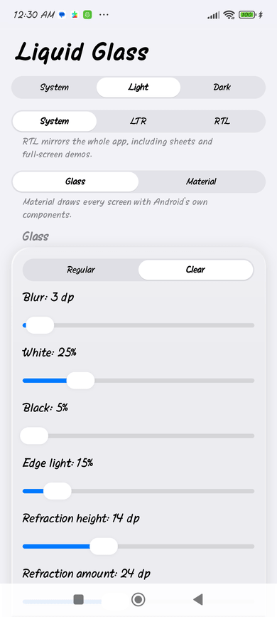</td>
<td>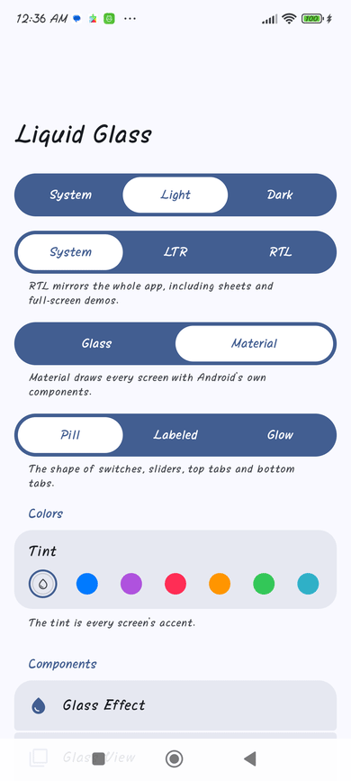</td>
<td>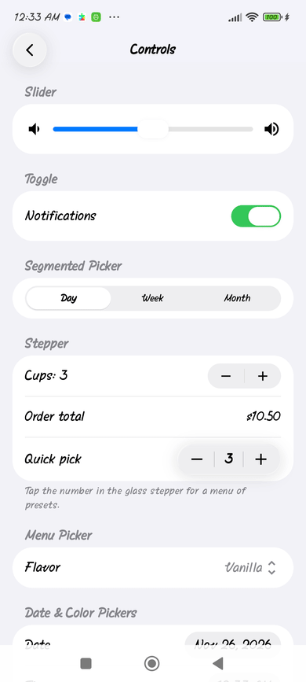</td>
<td>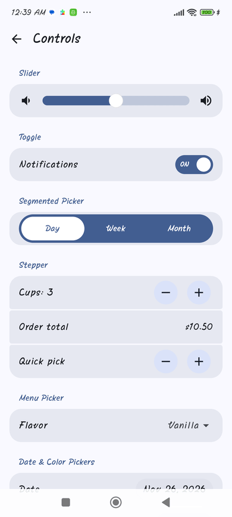</td>
</tr>
</table>

<table>
<tr><th>Liquid controls (glass)</th><th>Tab bar (glass)</th><th>Minimize on scroll (glass)</th><th>Glow controls (Material)</th></tr>
<tr>
<td>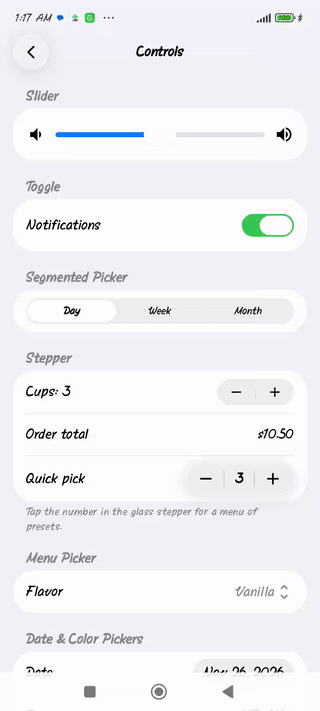</td>
<td>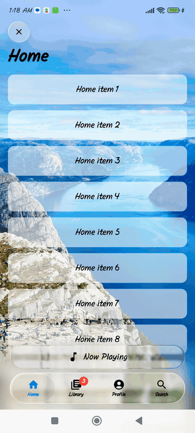</td>
<td>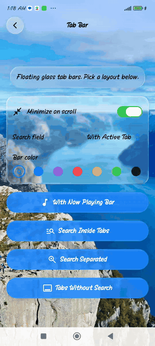</td>
<td>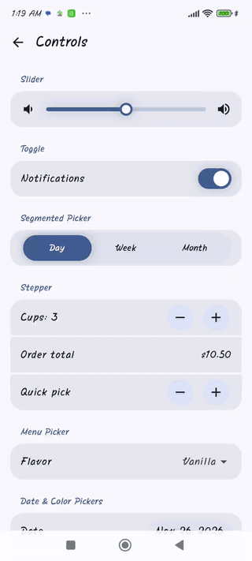</td>
</tr>
</table>

## Setup

In `android/build.gradle`, inside `buildscript { ext { … } }`:

```groovy
minSdkVersion = 26
compileSdkVersion = 37
targetSdkVersion = 36
kotlinVersion = "2.2.0"
```

- Android Gradle Plugin 9.1 or later (the example uses Gradle 9.4.1).
- `kotlinVersion` in `ext`: the library applies the Compose compiler plugin at that version.
- `newArchEnabled=true` (and, as verified, `edgeToEdgeEnabled=true`) in `android/gradle.properties`.
- The library brings Compose (BOM `2026.09.00`), material icons, activity-compose, navigationevent, lifecycle and AndroidSVG. Each version can be overridden from your root `ext` (for example `composeBomVersion`), but only the defaults are verified.

## First screen

```tsx
import { GlassControlsScreen } from '@native-dev-kit/react-native-liquid-glass';

export function ControlsDemo({ onBack }: { onBack: () => void }) {
  return <GlassControlsScreen style={{ flex: 1 }} onBack={onBack} />;
}
```

For a whole app with navigation, copy the recipe in [react-navigation.md](react-navigation.md). On Android, use the `ios_from_right` animation (`ios_from_left` in right-to-left) to get the iOS push slide; without it Android fades between screens.

## Back

- The screen's back arrow sends `onBack`.
- The system back key and back gesture first close what is open inside the screen: a sheet, a menu, a popover, an alert, the search field, a panel, the Tab Bar demo cover. When nothing is open, React Native gets the key and React Navigation pops. Do not add a `BackHandler` for glass screens.
- On Android 16 (API 36) and later, back events come through the activity's navigation event dispatcher, so the activity must be a `NavigationEventDispatcherOwner`. React Native's `ReactActivity` is.
- Below API 36 the library reads the back key through the activity window's `Window.Callback`. If another library replaces that callback without passing events on, back routing breaks until a glass screen enters the window again.
- With two glass screens visible at once (a transparent modal over another), the back key goes to the one that entered the window last.

## Glass or Material

```tsx
import { useMemo, type ReactNode } from 'react';
import { GlassSettingsProvider } from '@native-dev-kit/react-native-liquid-glass';

export function MaterialScreens({ children }: { children: ReactNode }) {
  const value = useMemo(() => ({ androidStyle: 'material' as const }), []);
  return <GlassSettingsProvider value={value}>{children}</GlassSettingsProvider>;
}
```

- `'glass'` reads the glass engine settings (`clear`, `blur`, `white`, `black`, `edgeLight`, `refraction`, `opaque`, `liquid`, `dropColor` and the liquid control switches). Home's Glass section changes them.
- `'material'` ignores them and uses Android's dynamic colours, with `tint` as the accent. Its switches, sliders and tabs take a control shape: `'pill'` (default), `'labeled'` or `'glow'`.
- Details: [android-style.md](android-style.md), [control-shapes.md](control-shapes.md).

## Appearance and system bars

`appearance` changes the glass screen only (its Compose theme) plus the status and navigation bar icons: dark icons in light, light icons in dark. Your React Native views are not changed. The latest mounted glass screen wins; when the last one unmounts, the app's own icon setting comes back, and an icon style your app set with `<StatusBar>` in the meantime is kept.

<table>
<tr><th>Dark</th><th>Right-to-left</th><th>Buttons, right-to-left</th></tr>
<tr>
<td>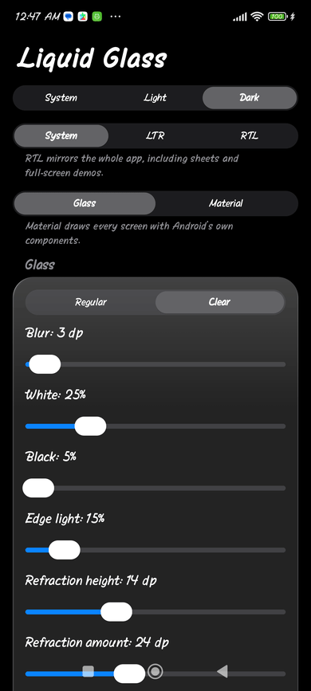</td>
<td>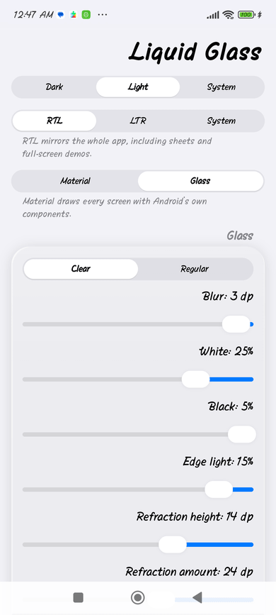</td>
<td>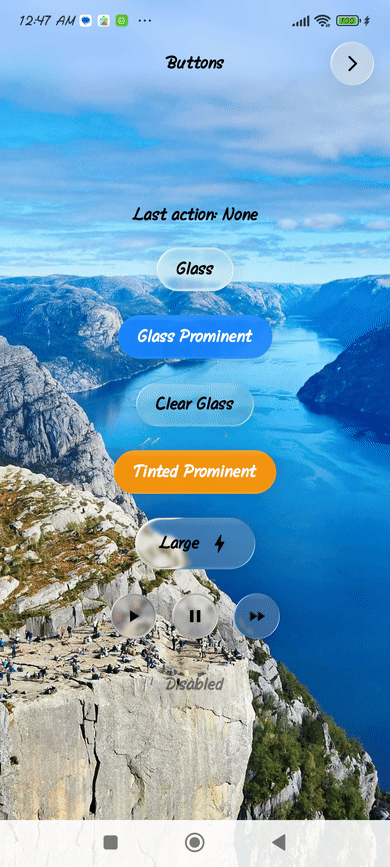</td>
</tr>
</table>

On Xiaomi phones (MIUI) in system dark mode, the status bar icons follow the content under them, so the Floating Header in Light may show white icons. That is the phone's behaviour.

## Fonts on Android

Put the files in `android/app/src/main/assets/fonts/` (the file name without the extension is the name), or register a family with `ReactFontManager.getInstance().addCustomFont(…)`. The library loads fonts through React Native's own font manager, so the names your `Text` styles use work unchanged. Both styles take the font, including Material's type scale. See [fonts.md](fonts.md).

<table>
<tr><th>Home with Cairo</th><th>Buttons with Cairo and custom icons</th><th>Tab bar demo with Cairo and custom icons</th></tr>
<tr>
<td>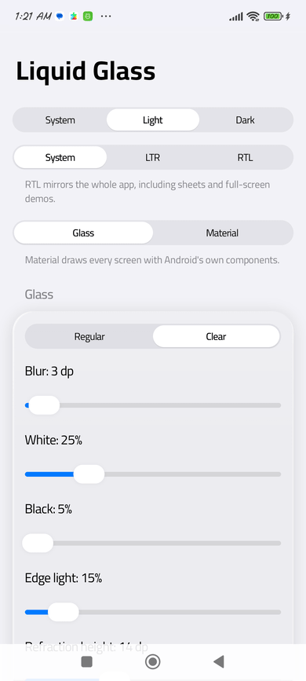</td>
<td>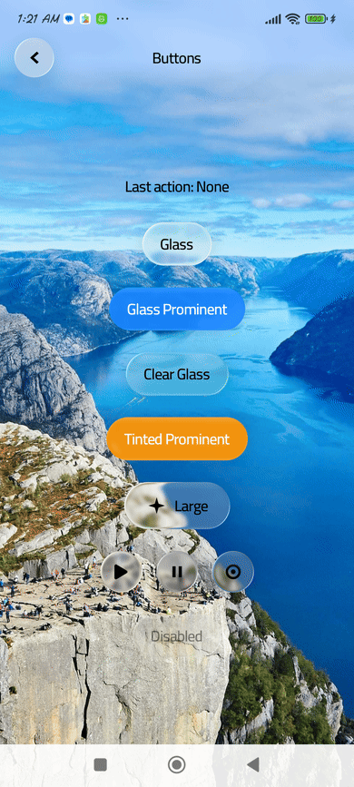</td>
<td>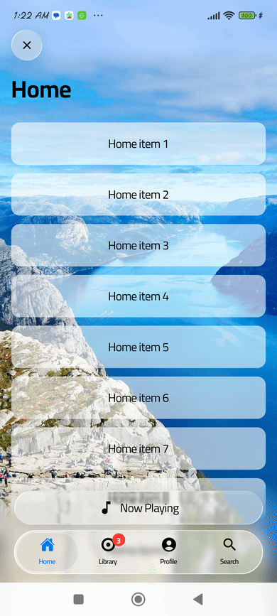</td>
</tr>
</table>

## Icons on Android

Your icons replace the Material icons at the same places, keyed by the SF Symbol name the iOS screen uses there. SVGs are drawn with AndroidSVG. Remote images wait at most 10 seconds and keep the native icon on failure. See [icons.md](icons.md).

## Right-to-left on Android

`'system'` follows React Native's `I18nManager.isRTL`, so glass screens agree with your React Native screens. Everything mirrors, except media players (they stay left to right). Text reads in its own script's direction, so an English sentence keeps its period last in right-to-left. See [layout-direction.md](layout-direction.md).

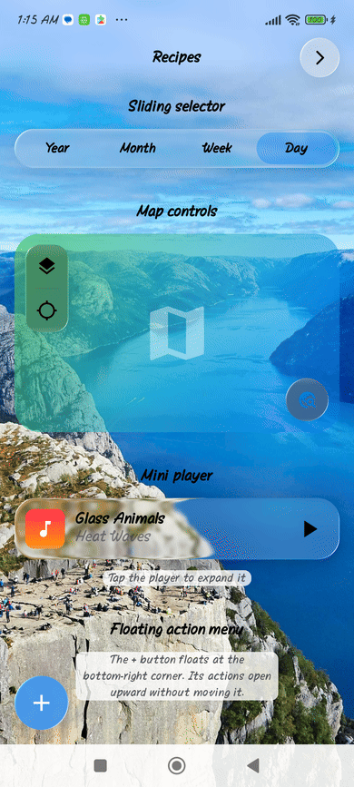

## Testing on a device

Build Release to test without Metro: `npx react-native run-android --mode release`. Run the library's JVM tests from your checkout with `cd example/android && ./gradlew :native-dev-kit_react-native-liquid-glass:testDebugUnitTest`.
