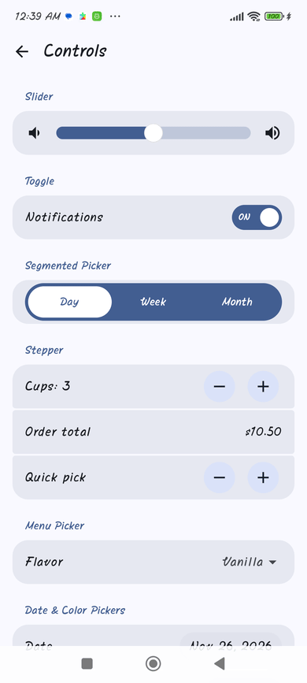
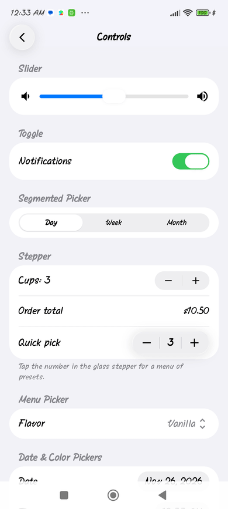

# Android control shapes

```ts
// In GlassSettings, and as props of every screen:
type ControlShapeSettings = {
  androidControlShape?: 'pill' | 'labeled' | 'glow'; // default 'pill'; Material only; iOS ignores it
  androidGlowIntensity?: number; // 0 (no glow) to 1; default 0.35; only 'glow' uses it
};
```

<table>
<tr><th>Material, <code>'pill'</code> (default)</th><th>Glass (liquid controls, no shape)</th></tr>
<tr>
<td></td>
<td></td>
</tr>
</table>

- Android, [`androidStyle: 'material'`](android-style.md) only. Glass keeps its liquid controls (with the drop, and `sliderLiquid`, `switchLiquid`, `segmentedLiquid`, `tabBarLiquid`, `tabBarDrop`, `dropColor`). iOS is unchanged.
- Set it in `GlassSettings` (the provider applies it to every screen) or as a prop on one screen. The prop wins.
- An older option, `androidSegmentedCheck` (a check on the stock segmented buttons), was removed with those buttons; the shapes replace it.
- It shapes four Material controls: the switch, the slider, the segmented control (top tabs) and the bottom tab bar. Everything else keeps its style.
- `'pill'` is the default: a Material app that sets nothing gets pill controls. An unknown value (or the old `'default'` / `'squared'`) is `'pill'` too.
- `androidGlowIntensity` sets how strongly `'glow'` glows. Native code clamps it to 0..1; 0 draws the glow shape without a halo, 1 is the strongest. Same provider / screen-prop rules.
- In Material, Android Home has a picker for it (Pill / Labeled / Glow), plus a Glow intensity slider while Glow is picked, and sends `onSettingsChange` with the new values.

| Shape | Switch | Slider | Top tabs | Bottom tabs |
|---|---|---|---|---|
| `'pill'` | A solid pill in the accent with ON / OFF inside and a white thumb; gray when off | A thick rounded track with a white round handle | An accent pill; the selected tab is a white pill inside it | An accent bar with a white pill behind the selected tab |
| `'labeled'` | An outlined pill with ON / OFF and a filled thumb | A ring handle on a thin track | Outlined; the selected tab is filled | An outlined bar; the selected tab is filled |
| `'glow'` | Glows when on | A glowing track with a ring handle | The selected tab glows | The selected tab glows |

- Colours come from the accent: a control's own colour (a slider's tint, the Tab Bar screen's bar colour), else the Material primary (which is `tint`, adjusted for contrast). Text and marks on the accent are white or black, whichever reads better; text in the accent on white is used only at 4.5:1. Light and dark both work.
- RTL mirrors every shape: the switch's on side, the slider's fill and the selected tab follow the direction.
- TalkBack reads them as Android's own controls: a switch row reads its label and state, a slider its label and value ("Volume, 50%") and you can adjust it, a tab its label and whether it is selected.
- Touch targets are at least 48 dp. Presses show ripples, and the controls take keyboard / D-pad focus (the slider moves with the arrow keys, Page Up / Down, Home and End). The slider gives a light haptic each tenth of the way. The marker and thumb move with a spring; there is no liquid drop.
- The bottom bar floats above the system navigation bar in its own container colour; content scrolls under it.
- ON / OFF are fixed English labels at a fixed size, so they fit at any font scale.

```tsx
import { useMemo } from 'react';
import {
  GlassControlsScreen, GlassHomeScreen, GlassSettingsProvider,
} from '@native-dev-kit/react-native-liquid-glass';

// Material with labeled controls everywhere, and a stronger glow for any screen that picks 'glow'.
export function LabeledHome() {
  const value = useMemo(
    () => ({
      androidStyle: 'material' as const,
      androidControlShape: 'labeled' as const,
      androidGlowIntensity: 0.6,
    }),
    []
  );
  return (
    <GlassSettingsProvider value={value}>
      <GlassHomeScreen style={{ flex: 1 }} />
    </GlassSettingsProvider>
  );
}

// Glowing controls on this screen, in Material, whatever the provider says.
export function GlowControls() {
  return (
    <GlassControlsScreen
      androidStyle="material"
      androidControlShape="glow"
      androidGlowIntensity={1}
      style={{ flex: 1 }}
    />
  );
}
```
