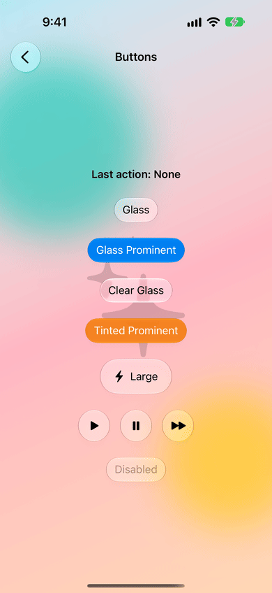
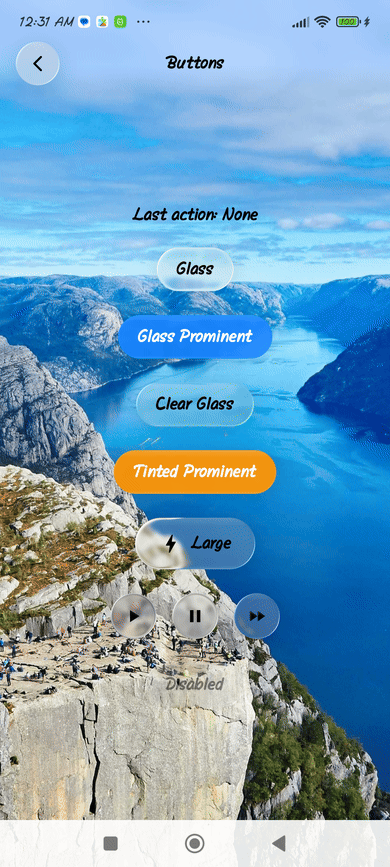
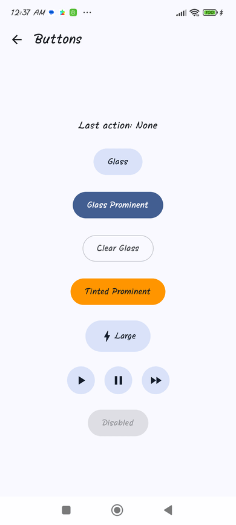

# Getting started

## What you get

Native screens. Each component (`GlassHomeScreen`, `GlassButtonsScreen` and the others) shows one whole screen of a native app: on iOS a SwiftUI screen with Apple's Liquid Glass, on Android a Jetpack Compose screen with a glass engine (or Material 3). The screen draws its own title bar, back button, content, sheets, menus and dialogs. You do not pass children, and you cannot put React Native views inside it.

<table>
<tr><th>iOS</th><th>Android, glass</th><th>Android, Material</th></tr>
<tr>
<td></td>
<td></td>
<td></td>
</tr>
</table>

## Requirements

- React Native 0.88 (the verified version), New Architecture on. The library is a Fabric component; the old architecture is not supported.
- A bare React Native CLI app. Expo is not supported yet.
- iOS 27.0 or later.
- Android 8 (API 26) or later, built with compileSdk 37 and Android Gradle Plugin 9.1. The Android screens use the Compose BOM `2026.09.00`, which needs that toolchain.

## 1. Install the package

```sh
npm install @native-dev-kit/react-native-liquid-glass
```

or `yarn add @native-dev-kit/react-native-liquid-glass`. Autolinking adds the native code; there is nothing to register by hand.

## 2. iOS

1. In `ios/Podfile`, set the platform to iOS 27:

   ```ruby
   platform :ios, '27.0'
   ```

2. Install the pods. CocoaPods needs a UTF-8 locale:

   ```sh
   cd ios && LANG=en_US.UTF-8 LC_ALL=en_US.UTF-8 pod install
   ```

3. Set the app target's deployment target to 27.0 in Xcode if it is lower.

The pod is `ReactNativeLiquidGlass` (Swift and Objective-C++, Swift 5 mode). It depends on `SwiftDraw` for SVG icons. More: [ios.md](ios.md).

## 3. Android

In `android/build.gradle`:

```groovy
buildscript {
    ext {
        minSdkVersion = 26
        compileSdkVersion = 37
        targetSdkVersion = 36
        kotlinVersion = "2.2.0"
    }
}
```

- Use Android Gradle Plugin 9.1 or later and a Gradle version it supports (the example uses Gradle 9.4.1).
- The library applies the Kotlin Compose compiler plugin at your app's `kotlinVersion`, so set `kotlinVersion` in `ext`.
- The example app runs with `newArchEnabled=true` and `edgeToEdgeEnabled=true` in `android/gradle.properties`. That is the verified setup.

The library brings Jetpack Compose (Material 3, material icons, activity-compose) and AndroidSVG for SVG icons. More: [android.md](android.md).

## 4. Show a screen

Every screen needs a size. The component has no default style, so pass `style={{ flex: 1 }}` (or any style that gives it a size):

```tsx
import { GlassButtonsScreen } from '@native-dev-kit/react-native-liquid-glass';

export function ButtonsDemo({ onClose }: { onClose: () => void }) {
  return <GlassButtonsScreen style={{ flex: 1 }} onBack={onClose} />;
}
```

`onBack` fires when the user taps the screen's own back button. Without a `GlassSettingsProvider`, screens use `DEFAULT_SETTINGS`.

## 5. Add navigation and settings

Most apps put the screens in React Navigation's native-stack, with Home's `onOpen` pushing a screen and each screen's `onBack` going back. Follow [react-navigation.md](react-navigation.md).

To let Home's settings (appearance, layout direction, tint, the Android options) change every screen, keep the settings in state, pass them to `GlassSettingsProvider`, and feed Home's `onSettingsChange` back into that state. See [settings.md](settings.md).

## 6. Run it

```sh
npx react-native run-ios
npx react-native run-android
```

Debug builds load JavaScript from Metro on port 8081: make sure the Metro on 8081 is this app's. To check on a device without Metro, build Release (`--mode Release` on iOS, `--mode release` on Android): the JavaScript bundle is then inside the app.

## Next

- [USAGE.md](../USAGE.md): every screen with screenshots and animations.
- [screens.md](screens.md): every screen and its props.
- [fonts.md](fonts.md), [icons.md](icons.md), [layout-direction.md](layout-direction.md), [android-style.md](android-style.md).
- [troubleshooting.md](troubleshooting.md): known limits.
