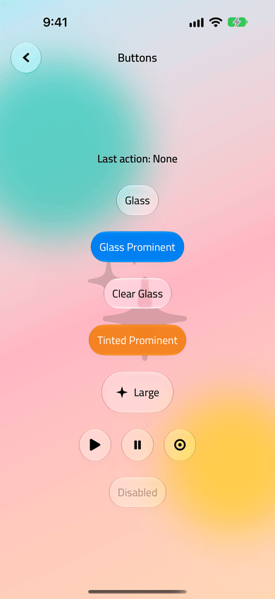

# Icons

Replace any icon the screens draw with your own: a glyph from an icon font, SVG markup, or an image.

```ts
import type { ImageSourcePropType } from 'react-native';

// In GlassSettings, and as a prop of every screen:
type IconSettings = {
  icons?: Record<string, GlassIcon | undefined>; // key: the SF Symbol name the screens use there
};

type GlassIcon =
  | { glyph: string; fontFamily: string } // an icon font glyph: use vectorIcon()
  | { svg: string }                       // SVG markup
  | ImageSourcePropType;                  // require('./icon.png'), { uri: 'https://…' }

declare function vectorIcon(
  iconSet: { getRawGlyphMap(): Record<string, number>; getFontFamily(): string },
  name: string
): GlassIcon | undefined;
```



The example's sample icons on iOS: an SVG star, an Ionicons play glyph, a PNG target and an SVG back chevron (`CUSTOMIZE = true` in `example/src/customize.ts`).

## How it works

- Set `icons` in `GlassSettings` (the provider sets it for every screen) or as the `icons` prop of one screen. A screen's map is merged over the provider's, key by key; a key set to `undefined` keeps the native icon on that screen.
- **Keys are SF Symbol names, on both platforms**: `'heart'`, `'square.and.arrow.up'`, `'magnifyingglass'`. Each Android icon is tied to the SF Symbol the iOS screen shows in the same place, so one map works on both.
- An icon that is not in the map stays native.
- Your icon takes the original icon's place, size and colour: it is drawn as a template, so its own colours are ignored and the screen's tint colours it. It works in buttons, bars, toolbars, tab bars, menus, lists and controls, in the glass and the Material style.
- **Right-to-left:** your icon mirrors exactly when the symbol it replaces mirrors. `chevron.backward` mirrors, so a custom back icon drawn pointing left points right in RTL; `heart` does not mirror.
- **Screen readers:** VoiceOver and TalkBack read the icon as they read the original.
- Define the map outside your components, or memoise it.

## Sources

- **Icon fonts** (react-native-vector-icons and similar): `vectorIcon(IconSet, 'name')`. It returns `undefined` (with a development warning) when the set has no such name, and the native icon stays. The library does not depend on react-native-vector-icons: you pass the icon set, and the set's font must be in your app (Android: the set's Gradle setup or `assets/fonts`; iOS: `UIAppFonts`). A font the app did not add leaves the native icon.
- **SVG:** `{ svg: '<svg viewBox="0 0 24 24">…</svg>' }`. Drawn natively: AndroidSVG on Android, SwiftDraw on iOS. The library does not depend on react-native-svg. Give the SVG a `viewBox` (or a width and height). Invalid SVG leaves the native icon.
- **Images:** `require('./share.png')` or `{ uri: 'https://…' }`. They load in the background; until then, and if loading fails, the native icon shows. On Android a remote image waits at most 10 seconds. A list of sources uses the first one.

```tsx
import type { ReactNode } from 'react';
import Ionicons from 'react-native-vector-icons/Ionicons';
import {
  GlassSettingsProvider,
  vectorIcon,
  type GlassSettings,
} from '@native-dev-kit/react-native-liquid-glass';

// A back chevron that points left; it mirrors in RTL where the native one does.
const BACK =
  '<svg viewBox="0 0 24 24" xmlns="http://www.w3.org/2000/svg"><path d="M16 2 L5 12 L16 22 L19 19 L11 12 L19 5 Z"/></svg>';

const settings: GlassSettings = {
  icons: {
    'square.and.arrow.up': vectorIcon(Ionicons, 'share-outline'),
    'chevron.backward': { svg: BACK },
    'heart': require('./assets/heart.png'),
  },
};

export function WithIcons({ children }: { children: ReactNode }) {
  return <GlassSettingsProvider value={settings}>{children}</GlassSettingsProvider>;
}
```

## Which keys exist

Home's rows:

| Screen | Key | Screen | Key |
|---|---|---|---|
| Glass Effect | `drop.fill` | Sheets & Menus | `rectangle.bottomhalf.inset.filled` |
| Glass View | `rectangle.on.rectangle` | Controls | `slider.horizontal.3` |
| Interactive Glass | `hand.tap.fill` | Text | `textformat` |
| Buttons | `button.horizontal.fill` | Glass Transitions | `sparkles` |
| Glass Container | `square.on.square` | Search | `magnifyingglass` |
| Morphing | `wand.and.stars` | Edit & Search Buttons | `pencil.and.list.clipboard` |
| Union | `circle.grid.2x1.fill` | Scroll Edge & Bars | `rectangle.topthird.inset.filled` |
| Toolbar | `menubar.rectangle` | Sidebar & Inspector | `sidebar.leading` |
| Floating Header | `rectangle.portrait.topthird.inset.filled` | Zoom Transitions | `arrow.up.left.and.arrow.down.right` |
| Tab Bar | `dock.rectangle` | Alerts & Dialogs | `exclamationmark.bubble` |
| | | Recipes | `square.grid.2x2.fill` |

Home's row chevron is `chevron.forward`; every screen's back button is `chevron.backward`, and full-screen demos close with `xmark`.

Keys used inside the screens include: `arrow.counterclockwise`, `arrow.down.right.and.arrow.up.left`, `arrow.up`, `arrow.up.arrow.down`, `backward.fill`, `bell`, `bell.fill`, `bell.slash`, `binoculars.fill`, `bolt.fill`, `books.vertical`, `camera.fill`, `checklist`, `checkmark`, `checkmark.circle`, `circle.dashed`, `circle.fill`, `circle.lefthalf.filled`, `cloud.bolt.rain.fill`, `doc.on.doc`, `drop`, `ellipsis`, `envelope.badge`, `eraser.fill`, `exclamationmark.triangle`, `eye`, `forward.fill`, `gearshape`, `hand.tap`, `heart`, `heart.fill`, `house`, `info`, `info.circle`, `line.3.horizontal.decrease`, `location`, `location.fill`, `map`, `map.fill`, `minus`, `moon.fill`, `moon.stars.fill`, `music.note`, `note.text`, `paintpalette`, `pause.fill`, `pencil`, `person.fill`, `photo`, `photo.artframe`, `play.fill`, `plus`, `scribble.variable`, `shuffle`, `speaker`, `speaker.wave.3`, `square.and.arrow.up`, `square.and.pencil`, `star`, `star.fill`, `star.slash`, `sun.rain.fill`, `trash`, `tray.fill`, `xmark.circle`, `xmark.circle.fill`.

To find the key for an icon you see, look up the screen in the iOS sources (`ios/Catalog/Screens/*.swift`): the name in `GlassImage("…")` or `glassImage: "…"` at that place is the key.

## Icons that stay native

The system draws a few icons itself, and they cannot be replaced: steppers (− and +), the iOS search field (`.searchable`) and the Material search bar's icons, menu-picker chevrons, the Material menu checkmark, swipe-to-delete, selection circles and drag handles. On Android the glass Search screen's field does take your `magnifyingglass` and `xmark`.

## Limits

- Glyphs and SVGs appear at once on iOS; on Android the first frame can show the native icon while yours is drawn.
- Drawn icons and loaded images are kept for the life of the app. That is fine for the few icons a screen uses; do not feed it hundreds of large images.
