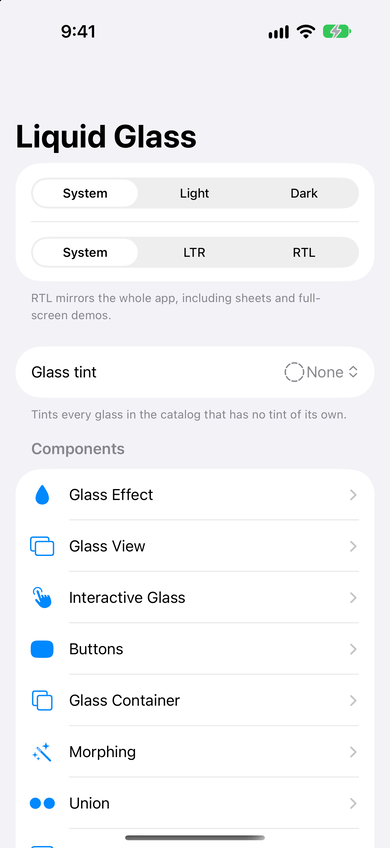
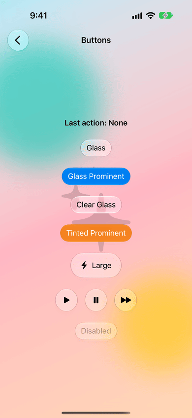
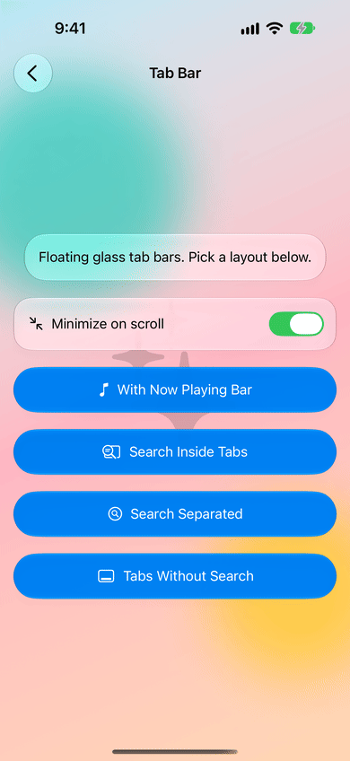
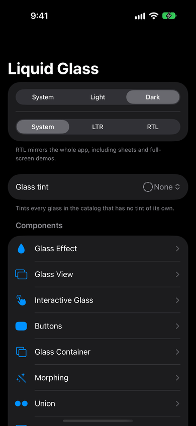
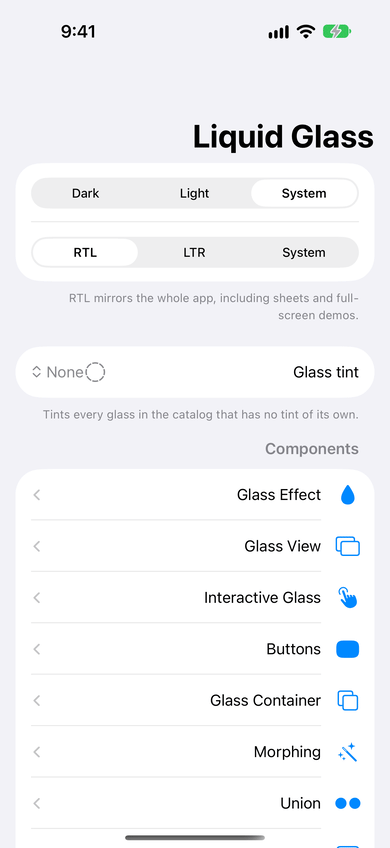
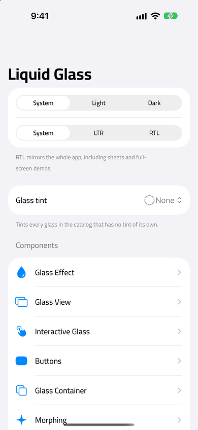
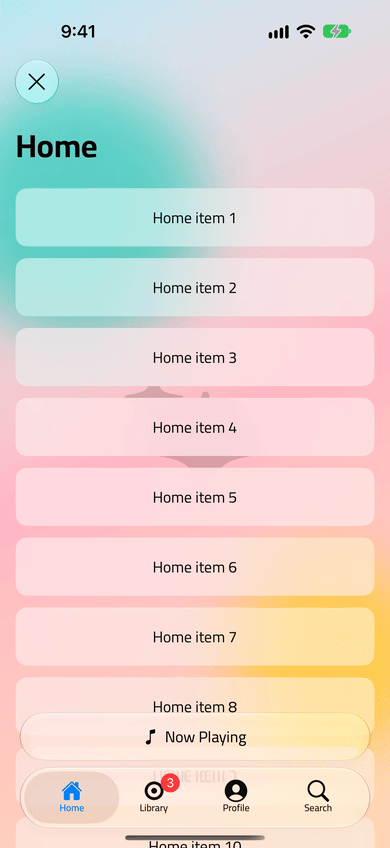

# Using the library on iOS

On iOS every screen is a SwiftUI screen of a native catalog app, with Apple's real Liquid Glass (iOS 27). This page covers what is specific to iOS. The shared steps are in [getting-started.md](getting-started.md).

<table>
<tr><th>Home</th><th>Buttons</th><th>Tab Bar</th></tr>
<tr>
<td></td>
<td></td>
<td></td>
</tr>
</table>

## Setup

1. `platform :ios, '27.0'` in `ios/Podfile`, and the app target's deployment target 27.0.
2. `cd ios && LANG=en_US.UTF-8 LC_ALL=en_US.UTF-8 pod install` (CocoaPods needs a UTF-8 locale).
3. Keep the New Architecture on (the React Native 0.88 default).

The pod `ReactNativeLiquidGlass` brings `SwiftDraw` (SVG icons). Nothing else to add.

## First screen

```tsx
import { GlassHomeScreen } from '@native-dev-kit/react-native-liquid-glass';

export function Start({ onOpen }: { onOpen: (id: string) => void }) {
  return <GlassHomeScreen style={{ flex: 1 }} onOpen={onOpen} />;
}
```

For a whole app with navigation, copy the recipe in [react-navigation.md](react-navigation.md).

## How a screen behaves on iOS

- Each screen sits in its own SwiftUI `NavigationStack` with its own bar. The back button is a glass `chevron.backward` button that sends `onBack`. The edge swipe back is native-stack's own gesture (from the left edge, or the right edge in right-to-left).
- Sheets, popovers, alerts and full-screen covers are native and open over the screen.
- When you push a screen, its own bar slides in with it (the native app cross-fades one shared bar instead).

## Settings on iOS

- iOS reads `appearance`, `tint`, `layoutDirection`, `fontFamily` and `icons`. The Android settings are ignored.
- **`appearance` is window-wide.** A screen asking for `'light'` or `'dark'` sets the window's style, so your React Native screens and the status bar change too. The latest mounted glass screen wins; when the last one unmounts, the window's own style comes back. `'system'` never touches the window. Details: [settings.md](settings.md#appearance).
- Home's tint picker shows None, Blue, Purple, Pink, Orange, Green and Teal. Any other colour still tints the glass, and Home shows None.

<table>
<tr><th>Dark</th><th>Right-to-left</th></tr>
<tr>
<td></td>
<td></td>
</tr>
</table>

## Status bar

Glass screens set their own status bar style through the window. Under native-stack, React Native's `<StatusBar>` component has no effect on iOS (react-native-screens owns the status bar); for your own screens use the native-stack option `statusBarStyle`.

The status bar text follows the glass screen's appearance even when it differs from the system's (light text on a dark screen on a Light system), and goes back when the screen asks for `'system'` or unmounts.

## Fonts on iOS

Add the font files to the app target and list them under `UIAppFonts` in `Info.plist`. Use the font's PostScript name (for a single family string, the family name). Navigation titles, bar buttons, tab bars, segmented controls and search fields take the font too; alerts, context menus, pickers, the share sheet and the keyboard keep the system font. See [fonts.md](fonts.md).

<table>
<tr><th>Home with Cairo and custom icons</th><th>Tab bar demo with Cairo and custom icons</th></tr>
<tr>
<td></td>
<td></td>
</tr>
</table>

## Icons on iOS

Icon-font glyphs and SVGs (drawn with SwiftDraw) appear at once; images load in the background and keep the system icon if they fail. Toolbar, menu and tab bar items take your icon too. The search field (`.searchable`) and steppers keep their system icons. See [icons.md](icons.md).

## Right-to-left on iOS

- `'system'` follows the device language **only if your app is localized for it**: iOS reports right-to-left only for an app with a right-to-left localization (for example an `ar.lproj` folder, or `ar` in `CFBundleLocalizations`). React Native's `I18nManager.isRTL` follows the same rule.
- UIKit pieces (menu rows, the open search field) and full-screen covers stay left-to-right in a forced `'rtl'` unless your app sets the window scene's layout-direction trait. That same trait override fixes the iOS 26+ native-stack back button that loses its chevron. Code and details: [layout-direction.md](layout-direction.md).

## Tab bar

The Tab Bar demos minimize the floating tab bar as you scroll down, driven by iOS with the system animation; scrolling back up brings it back.

## Testing on a device

Build Release to test without Metro: `npx react-native run-ios --mode Release`. If a Debug build shows a red box from another app's code, another project's Metro holds port 8081.
