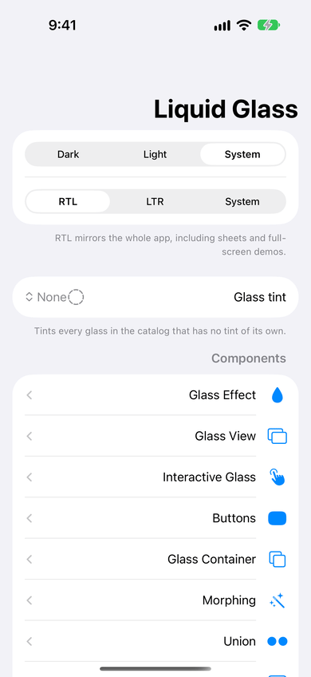
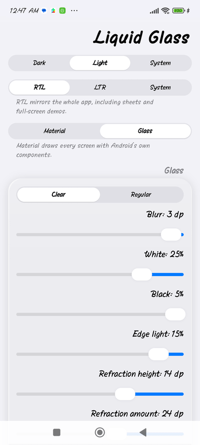
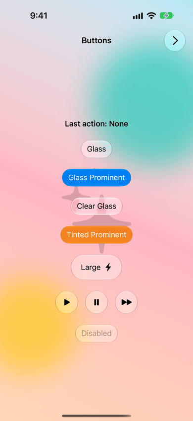
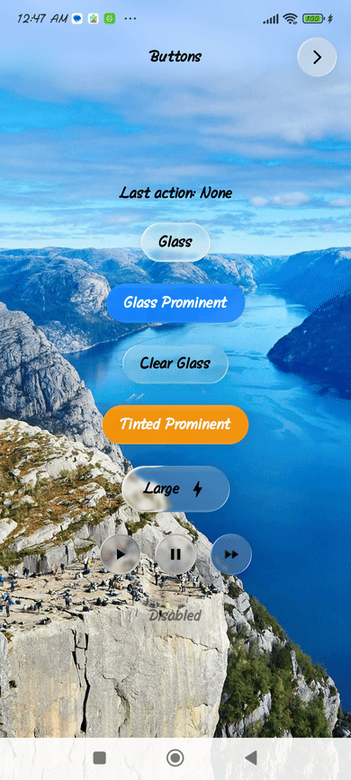
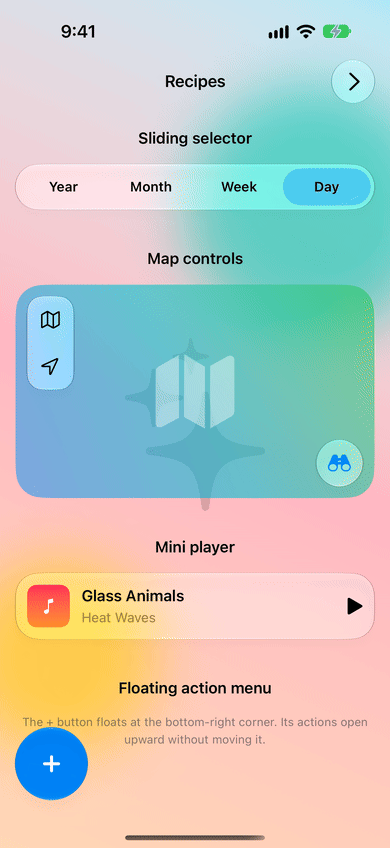

# Layout direction (right-to-left)

```ts
// In GlassSettings:
type LayoutDirectionSetting = {
  layoutDirection?: 'system' | 'ltr' | 'rtl'; // default 'system'
};
```

`'ltr'` and `'rtl'` force a direction for the glass screens. `'system'` follows the device:

- **iOS:** the system layout direction. iOS reports right-to-left only when the device language is right-to-left **and your app is localized for it** (for example an `ar.lproj` folder, or `ar` in `CFBundleLocalizations`). An English-only app stays left-to-right on an Arabic iPhone, and React Native's `I18nManager.isRTL` stays `false` there too.
- **Android:** React Native's own direction, `I18nManager.isRTL` (device language, `allowRTL`, `forceRTL`), so the glass screens agree with your React Native screens.

It works on both platforms. Set it in the provider, or let the user pick it on Home: both Homes have the "Layout direction" picker (System, LTR, RTL) under Appearance, and Home sends the choice through `onSettingsChange`.

It changes only the glass screens. Your React Native views follow React Native's `I18nManager`.

<table>
<tr><th>iOS Home</th><th>Android Home</th><th>iOS Buttons</th><th>Android Buttons</th></tr>
<tr>
<td></td>
<td></td>
<td></td>
<td></td>
</tr>
</table>

```tsx
import { useMemo } from 'react';
import { GlassSettingsProvider } from '@native-dev-kit/react-native-liquid-glass';

export function ForceRtl({ children }: { children: React.ReactNode }) {
  const value = useMemo(() => ({ layoutDirection: 'rtl' as const }), []);
  return <GlassSettingsProvider value={value}>{children}</GlassSettingsProvider>;
}
```

## What mirrors

- **iOS:** the screens mirror the way SwiftUI mirrors any app: the layout flips and the back button moves to the right, its chevron pointing the other way.
- **Android:** the same as iOS. The back arrow moves to the right and points the other way. Sliders fill from the right, switch thumbs and liquid drops slide toward the reading direction, segmented controls, tab bars and sliding selectors follow the selected item, menus and popovers grow from their button's leading side, minimizing tab bars shrink into the leading circle, and sheets, dialogs and the context menu preview follow too.
- Icons that SF Symbols mirrors (back and forward chevrons, list and sidebar icons) mirror on both platforms. Media controls, checkmarks and similar symbols do not. A [custom icon](icons.md) mirrors exactly when the symbol it replaces does.
- Media players stay left-to-right on both platforms, as the HIG and Material ask: media controls follow time, not reading direction. The Recipes mini player (artwork, title, play button), its progress slider and transport row, the Buttons media row and the Tab Bar's Now Playing accessory keep their LTR layout in an RTL screen.




## Screen transitions in RTL

In RTL a pushed screen comes in from the left, as `UINavigationController` does. With native-stack, give the container the direction and pick the Android animation from it:

```tsx
import { I18nManager, Platform } from 'react-native';
import type { GlassSettings } from '@native-dev-kit/react-native-liquid-glass';

export function isRtl(settings: GlassSettings) {
  const direction = settings.layoutDirection ?? 'system';
  return direction === 'rtl' || (direction === 'system' && I18nManager.isRTL);
}

export function stackOptions(settings: GlassSettings) {
  return {
    headerShown: false,
    // Android's slides are absolute, so they follow the direction by hand.
    animation: Platform.select({
      android: isRtl(settings) ? ('ios_from_left' as const) : ('ios_from_right' as const),
      default: 'default' as const,
    }),
  };
}

// <NavigationContainer direction={isRtl(settings) ? 'rtl' : 'ltr'}>
//   <Stack.Navigator screenOptions={stackOptions(settings)}>
```

- **Android:** `ios_from_left` in RTL, `ios_from_right` in LTR. The back key slides the screen out to the left.
- **iOS:** the system push (`default`) in both directions. `direction` sets the `UINavigationController`'s direction, so in RTL UIKit pushes from the left and the edge and content swipes start at the right.
- **Always pass `direction`.** React Navigation defaults it to `I18nManager.isRTL`. An Arabic app that shows the screens in LTR would then push from the left.

The example app does this in `example/src/App.tsx`, plus the iOS trait override below.

### iOS 26: the back button loses its chevron in run-time RTL

With native-stack, `direction` mirrors the stack only through `semanticContentAttribute` (react-native-screens). UIKit's own layout direction (the trait) stays the system's. On iOS 26 and later the glass back button is laid out by the trait and its chevron by the forced attribute. When the app's direction differs from the device's (an RTL app on an English device, or the reverse), they disagree and the chevron collapses to zero width: an empty glass button.

Your app needs the fix when it picks the direction at run time (a `layoutDirection` other than `'system'`) and shows a native-stack header on iOS 26+. Set the window scene's trait to match, from a small native module of your app:

```objc
// MyLayoutDirection.m, in your app target
#import <React/RCTBridgeModule.h>
#import <UIKit/UIKit.h>

@interface MyLayoutDirection : NSObject <RCTBridgeModule>
@end

@implementation MyLayoutDirection
RCT_EXPORT_MODULE()
- (dispatch_queue_t)methodQueue { return dispatch_get_main_queue(); }

// "rtl", "ltr" or "system" (removes the override).
RCT_EXPORT_METHOD(setDirection : (NSString *)direction)
{
  for (UIScene *scene in UIApplication.sharedApplication.connectedScenes) {
    if (![scene isKindOfClass:UIWindowScene.class]) continue;
    id<UITraitOverrides> overrides = ((UIWindowScene *)scene).traitOverrides;
    if ([direction isEqualToString:@"system"]) [overrides removeTrait:UITraitLayoutDirection.class];
    else overrides.layoutDirection = [direction isEqualToString:@"rtl"]
        ? UITraitEnvironmentLayoutDirectionRightToLeft : UITraitEnvironmentLayoutDirectionLeftToRight;
  }
}
@end
```

```tsx
import { useEffect } from 'react';
import { NativeModules } from 'react-native';
import type { GlassSettings } from '@native-dev-kit/react-native-liquid-glass';

// Call it next to <NavigationContainer direction={…}>, with the provider's settings.
export function useNativeLayoutDirection(settings: GlassSettings) {
  useEffect(() => {
    NativeModules.MyLayoutDirection?.setDirection(settings.layoutDirection ?? 'system');
  }, [settings.layoutDirection]);
}
```

On iPad with several windows, also apply it to scenes that connect later (`UISceneWillConnectNotification`). The example's `example/ios/ReactNativeLiquidGlassExample/LayoutDirection.m` does both. The override flips all of UIKit, so with it the UIKit pieces listed under Known differences mirror too.

## Known differences

- **iOS full-screen covers stay left-to-right** without the trait override above. The Tab Bar "With Now Playing Bar" cover (tabs, close button, title) is not mirrored on iOS, even though Home's footer says RTL mirrors full-screen demos. Android mirrors it, and so does the example on iOS, which sets the override.
- **iOS pieces drawn by UIKit stay left-to-right** without the trait override above: menu rows stay left-aligned, and the open search field keeps its magnifier on the left. Android mirrors both. The example app sets the override, so in the example they mirror.
- **Android, text in the other script's direction:** text reads in its own script's direction, as in SwiftUI, so an English sentence keeps its period last in RTL. The cost is paragraph alignment:
  - In an RTL layout, a wrapped English paragraph aligns left on Android, where iOS keeps it right-aligned. Arabic and Hebrew text are right-aligned on both.
  - In an LTR layout, a wrapped Arabic or Hebrew paragraph (for example typed into a search field) aligns right on Android; iOS aligns it to the layout's leading edge, the left. This iOS case was not checked on a device.
  - The screens' own texts are English, so this only affects text the user types.
- **iOS, switching the direction on Home:** Home rebuilds its list for each direction, so after a switch that changes the direction the list opens at the top instead of keeping its scroll position. Without the rebuild, a list switched from RTL to LTR kept UIKit's RTL layout and was drawn mirrored.
